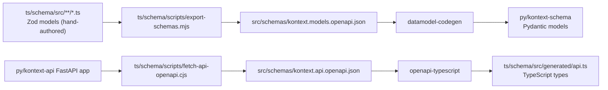

# Contract Pipeline

`ts/schema` is the Zod-first source of truth. The committed generated artifacts
must always match it exactly; the CI `generated-code` job regenerates and fails
on drift. The pre-commit hook only prints a reminder.

## Source-of-truth loop



Both committed specs are inputs to the generators; treat them as source, never
hand-edit.

## When to regenerate

Run after changing any of: Zod models under `ts/schema/src`, generator scripts,
OpenAPI assets, `py/kontext-api` router signatures that alter the API spec.

```bash
pnpm run generate:api-types     # regenerate ts/schema/src/generated/api.ts
pnpm run generate:models        # regenerate py/kontext-schema from the models spec
pnpm --filter @kontext-labs/schema run refresh-schemas  # re-export the models spec from Zod
pnpm run refresh:api-schema     # re-export the FastAPI OpenAPI doc
```

The Python path is pure Python: `datamodel-codegen` is pinned in the root
`uv.lock` under the `codegen` dependency group, so run `uv sync --group codegen`
once (or let `uv run --group codegen` resolve it).

Commit the regenerated artifacts together with the source change.

## Verification

```bash
pnpm --filter @kontext-labs/schema run check:contracts
pnpm check:generator-smoke
```

`check:contracts` runs the schema snapshot diff, OpenAPI validation, and the
contract-parity checks (which also pin the `SiteFeature` TS↔Python mirror).
Regenerating the API snapshot imports the FastAPI app, so it needs `uv`; the
Node-only `check:contracts:ts` variant skips it. CI runs `check:contracts:ts`
in the TypeScript lint job and the full suite in the generated-code job, where
both toolchains are installed. If the generated-code job fails in CI, it means
some path above was skipped.

## Rules

- Never edit `ts/schema/src/generated/api.ts` or the generated modules in
  `py/kontext-schema/src/kontext/schema/_generated/` by hand — fix the upstream
  Zod models and regenerate. The hand-written files beside it (`base.py`,
  `policies.py`, `__init__.py`) are the only editable files in that package;
  keep them policy-only, never per-model fields.
- Hand-copied mirrors of generated values (e.g. `SiteFeature`, permission
  claims) need a parity check wired into `check:contract-parity` before they
  can drift.
- The generated API types are part of `@kontext-labs/schema` and must not be
  versioned or published as a separate package. Regenerate them; do not bump a
  version or edit the output by hand.
