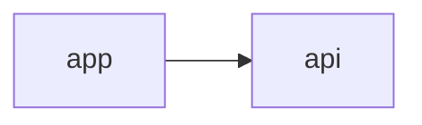

# Kontext Labs docs site

Astro Starlight site that publishes the user guide and selected developer
reference pages. The Markdown under `docs/` remains the source of truth; the
generated content collection is gitignored.

## Commands

```bash
pnpm docs:site:sync     # regenerate src/content/docs from docs/
pnpm docs:site:dev      # sync, then start the dev server
pnpm docs:site:build    # sync, then build to docs-site/dist
pnpm docs:site:preview  # serve the built site
```

`dev` and `build` run the sync first, so there is no separate step to remember.

## What is published

- The user guide: every page in `tools/docs-capture/pages.mjs` with
  `status: "published"`.
- The developer reference pages listed in `site-manifest.mjs`.

Plans, decision records, and roadmaps are deliberately excluded, even when they
live under `docs/`. To publish another reference page, add it to
`site-manifest.mjs`; it appears in the sidebar and the developer index.

## Diagrams

Pages rendered by the site can embed Mermaid diagrams in a standard fence:

````markdown

````

`astro-mermaid` is registered before the Starlight integration in
`astro.config.mjs`, so it claims `mermaid` fences before Expressive Code sees
them. Diagrams are rendered client-side and follow the site's light/dark theme.
Use Mermaid for architecture and flow diagrams; keep step-by-step prose,
directory trees, and literal command output as text.

## Configuration

| Variable | Default | Purpose |
| --- | --- | --- |
| `DOCS_SITE_URL` | `https://docs.kontext.tech` | Canonical site URL used by Starlight and the sitemap |
| `DOCS_BASE` | `/` | Base path when hosting under a prefix instead of a subdomain |
| `DOCS_REPO_URL` | `https://github.com/kontext-tech/kontext-labs` | Repository used for source links and the GitHub icon |

The sync step rewrites relative source links to site routes, links to source
files to repository URLs, and strips the capture markers that the user-guide
harness writes into the generated blocks.

## Publishing

`https://docs.kontext.tech` is served by a CloudFront distribution backed by an
S3 bucket. Both are defined in the separate `kontext-tech/kontext-platform`
repository (`DocsCloudFrontStack`), which also owns the Route53 `docs` record;
`kontext.tech` is delegated to Route53, so the subdomain is not configured in
Squarespace's DNS editor.

Content is published by `.github/workflows/publish-docs.yml`, either manually
(`workflow_dispatch`) or automatically as part of `release.yml`
(`publish_docs`, default `true`). The workflow builds `docs-site/dist`, syncs it
to S3, invalidates CloudFront, and smoke-tests the distribution.

Required repository configuration in `kontext-tech/kontext-labs`:

- secret `AWS_DEPLOYMENT_ROLE_ARN_GLOBAL` — the
  `kontext-production-cicd-global` role ARN
- environment `production` — optional protection rules for the deploy job

Deploy the docs infrastructure once from `kontext-platform` before the first
publish; until then the deploy job fails while resolving the stack outputs.
