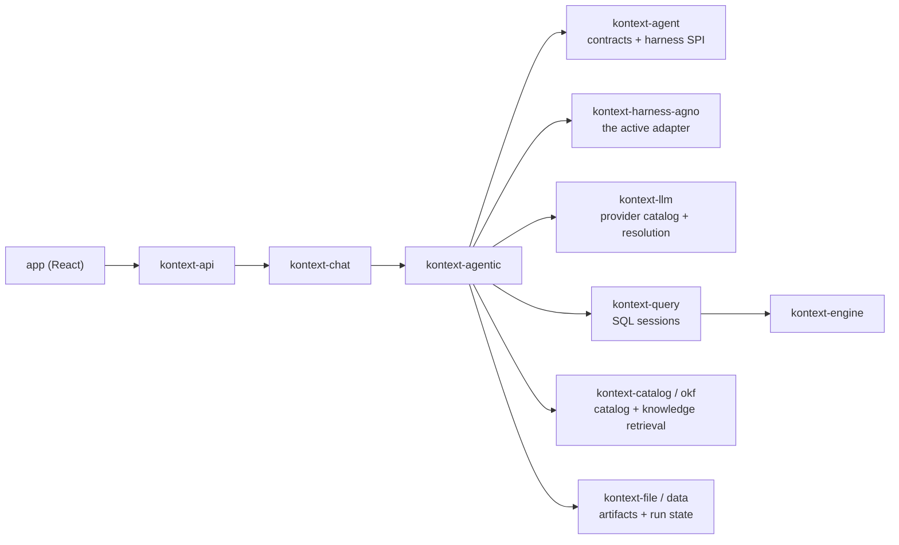

# AI architecture

Kontext's AI features run through a harness-neutral agent stack. Domain code
builds an `AgentSpec`, the active harness adapter materializes it, and every
capability reaches the model as a typed tool. The framework is a swappable
implementation detail; see [Harness abstraction](harness-abstraction.md).

## Layer map



- `kontext-agent` is the framework-agnostic contract layer: `AgentSpec`,
  `AgentKind`, `BaseAgenticSystem`, `AgentFrameworkAdapter`, tool metadata,
  streaming primitives, and the `SessionPersistence` port. It imports no
  harness SDK and contains no domain tools.
- `kontext-agentic` is the application layer: blueprints, domain tools, chat
  handling, and `create_agentic_system`.
- `kontext-harness-agno` is the only package that imports Agno. It maps a spec
  to an Agno `Agent` or `Team`, builds the native model, and translates run
  events back to neutral wire events.
- `kontext-llm` owns provider metadata and selection resolution. The adapter
  receives a `ModelRuntime` binding plus run-scoped credentials; it never reads
  the process-global credential store.
- `kontext-schema` owns the neutral wire contracts, including run events and
  tool-result schemas shared with the TypeScript client.

The adapter boundary is enforced by
`py/kontext-common/tests/test_architecture_boundaries.py`.

## Team composition

The coordinator blueprint composes four specialist blueprints: SQL, Chart,
Notebook, and Python. `AgentKind.COORDINATOR` is a blueprint selector, not a
runtime type; a spec with `members` can become an Agno `Team` or a hierarchical
agent in another harness. Members share session state, so table and artifact
handles written by one specialist are visible to the others.

Ownership is by artifact, not by language:

- **SQL Agent** discovers catalog metadata, writes and executes read-only SQL,
  and returns reusable `data_table_id` handles and previews.
- **Chart Agent** turns an existing data table into a chart artifact. It does
  not aggregate; grouped requests are routed through SQL first.
- **Notebook Agent** owns a notebook end to end, including the Python blocks it
  creates, edits, and executes. A notebook has one writer.
- **Python Agent** owns standalone, session-scoped analysis and does not mutate
  notebooks.
- **Coordinator** routes work, enforces ownership, verifies that required
  execution happened, and synthesizes the response.

Blueprints live in
`py/kontext-agentic/src/kontext/agentic/blueprints/`. They contain instructions
and tool composition only, never framework-specific code.

## Tools

Tools are typed methods on toolkit classes in
`py/kontext-agentic/src/kontext/agentic/tools/`:

| Toolkit | Responsibility |
| --- | --- |
| `ProjectTools` | Project overview and attached-data mapping |
| `CatalogTools` | Schema discovery and catalog search |
| `SqlTools` | Query execution, sampling, and result previews |
| `ChartTools` | Standalone chart creation, update, and import |
| `NotebookTools` | Block mutation, data tables, embedded charts, notebook persistence |
| `NotebookPythonTools` | Execution and persistence of notebook Python blocks |
| `PythonTools` | Standalone managed Python execution |
| `KnowledgeTools` | OKF concept search and knowledge proposals |

Tool results cross the HTTP boundary, so their shapes are defined once in
`ts/schema/src/ai/tool-results.ts` and generated into Pydantic models.
`ToolResultParser` in `kontext.agent.tools` validates payloads against the
registered result type. See [Tool result schemas](tool-results-schema.md).

## Request flow

1. The app sends a prompt with project, data-source, and attachment context to
   `kontext-api`.
2. `kontext-chat` creates or continues the session and calls
   `create_agentic_system`, which resolves harness -> blueprint -> `AgentSpec`.
3. The adapter materializes the spec with the resolved model runtime, tools, and
   platform-owned run-state store.
4. The agent calls tools. SQL goes through the `kontext-query` port to the
   active engine; artifacts persist through the owning domain service.
5. The adapter streams neutral `SimpleRunEvent`s to the API, which forwards
   them over SSE. A client-side tool pauses the run and resumes it when the
   result returns.
6. `SessionPersistence` stores platform-facing messages and an opaque
   harness-state blob. The adapter owns neither database nor deletion.

## Notebook generation

A notebook request becomes a durable artifact rather than a chat-only answer:

1. The coordinator gathers project context and routes to the Notebook Agent,
   with SQL or Chart help when the request needs data or visuals.
2. SQL produces reusable data handles; the Notebook Agent assembles markdown,
   data-table, SQL, chart, and Python blocks.
3. The Notebook Agent executes the Python blocks it creates and verifies the
   result before presenting the `notebook_id`.

Notebooks are persisted through `kontext-file`; the document model is described
in [Notebook system](../notebook/notebook-system.md).

## SQL validation

Agents can validate SQL before touching data. A shadow session is a normal
`DuckDBQueryEngine` session with `SessionConfig(shadow=True)`, which forces an
in-memory, non-persistent DuckDB instance populated with empty tables whose
columns and types are mapped from project catalog metadata:

```python
import asyncio

from kontext.engine.session.duckdb import DuckDBQueryEngine, SessionConfig


async def validate() -> None:
    engine = DuckDBQueryEngine(SessionConfig(project_id="your-project-id", shadow=True))
    await engine.create_session()
    is_valid, error = await engine.validate_sql("SELECT * FROM dataset1.table1")
    print(is_valid, error)
    engine.close_session()


asyncio.run(validate())
```

Because the tables are empty but fully typed, validation catches syntax,
missing-column, and cross-dataset join errors without reading data files. The
same session API serves live execution; only `shadow` changes the data source.

## Related documentation

- [Harness abstraction](harness-abstraction.md) — the adapter boundary,
  streaming contract, and storage rules.
- [Model provider configuration](model-provider-configuration.md) — how users
  configure providers and how a selection becomes a model binding.
- [Tool result schemas](tool-results-schema.md) — transport and domain layers
  for tool results.
- [Notebook system](../notebook/notebook-system.md) — the block document model
  and host integration.
- [Python package boundaries](../development/python-package-boundaries.md) —
  the enforced import graph across these packages.
