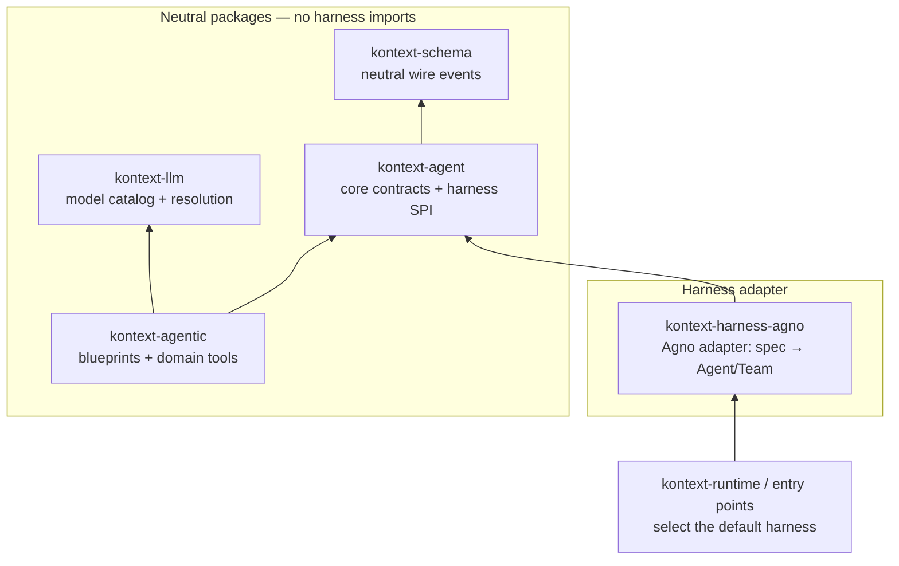

# Agent Harness Abstraction

Kontext's agent runtime is built on an abstraction layer so the AI framework
("harness") is a swappable implementation detail. Agno is the current default.
The seam is proven by the fact that no neutral package imports a harness SDK, so
a future adapter (e.g. Google ADK) can be added without touching domain code.

## The one rule

Only an adapter directory may import a harness SDK. Today that is:

- `py/kontext-harness-agno/src/kontext/harness/agno/` (Agno)

Every other package talks to the neutral contracts in `kontext-agent` and the
neutral wire schema in `kontext-schema`. This is enforced by
`py/kontext-common/tests/test_architecture_boundaries.py`
(`test_only_the_harness_adapter_imports_a_harness_sdk`).

## Layers

## Composition is a field, not a type

`AgentSpec` (`py/kontext-agent/src/kontext/agent/spec.py`) describes an agent
declaratively and carries its members:

- `members == ()` -> leaf agent (Agno `Agent`, ADK `LlmAgent`)
- `members != ()` -> coordinating agent (Agno `Team`, ADK `LlmAgent(sub_agents=...)`)

There is no neutral "team" type. `AgentKind.COORDINATOR` is a *blueprint
selector* only; it does not imply a distinct runtime type. This is what lets a
harness with a separate team class (Agno) and a harness with hierarchical agents
(ADK) share one spec.

## Registries

Two registries, deliberately in different packages:

- **Harnesses** (`kontext.agent.harness`): `AgentFrameworkAdapter` implementations
  materialize an `AgentSpec` into a `BaseAgenticSystem`. They register through
  the `kontext.agent_harnesses` entry-point group. This is the plugin boundary:
  an adapter imports `kontext-agent`, never `kontext-agentic`.
- **Blueprints** (`py/kontext-agentic/src/kontext/agentic/adapters.py`):
  `AgentKind -> Callable[[AgentCreationContext], AgentSpec]`, registered in
  `py/kontext-agentic/src/kontext/agentic/blueprints/`. This is application
  policy (instructions and tools), so it stays in the application layer.

`create_agentic_system` (application layer) resolves harness -> blueprint ->
spec -> materialize. Swapping harnesses therefore changes no blueprint, tool,
chat, execution, or API code.

## Selecting a harness

- `KONTEXT_AGENT_FRAMEWORK` names the default harness (`agno`).
- Out-of-repo harness distributions register through the
  `kontext.agent_harnesses` entry-point group.
- Composition roots call `seed_harness_logger_env()` before
  `configure_structured_logging()` so harness-owned loggers (e.g. `agno`) are
  normalized without hardcoding a framework in `kontext-common`.

## Composition contract (coordinator & members)

`AgentSpec` intents must produce the same *observable* behavior regardless of
the harness's internal primitive (`Team` classes, sub-agent hierarchies, or
plain loops):

- **`members == ()`** — leaf agent. **`members != ()`** — coordinating agent
  exposing one delegation tool per member (conventionally
  `delegate_task_to_member[_s]` display metadata is pre-registered in the
  `ToolRegistry`).
- **`share_member_interactions=True`** — member tool calls and text reach the
  client stream inline (in run order); the coordinator's UI shows member
  activity as it happens.
- **`add_member_history=True`** — on each delegation, a member receives its own
  prior messages for that session, so members resume where the coordinator
  left them.
- **`persist_member_responses=True`** — history replay contains the
  coordinator's delegation call and the member's final output (it arrives as
  the delegation tool result). Member-internal tool messages stay
  harness-internal: they ride the harness-state blob, not the platform-facing
  replay.
- **`session_state` (`SharedSessionStore`)** — the same mutable store instance
  (or the same persisted state post-M1) must be observable across the
  coordinator and all members within a session: artifacts and aliases written
  by a member are visible to the coordinator's subsequent tool calls.

Harnesses realize these intents however they like; conformance scenarios pin
the observable outcomes above (see
`assert_coordinator_delegation_contract`: delegation on the wire, real member
tool execution and live visibility, cross-member shared state, member output in
history).

## Streaming contract

Adapters stream `SimpleRunEvent`s to the client with neutral, adapter-shared
primitives:

- `EventBuffer` (`kontext.agent.streaming`) merges small content chunks
  (markdown-table-safe line-boundary flushes) before they reach the client.
- `BoundedEventQueue` (`kontext.agent.streaming`) bounds memory for abandoned
  consumers, appends the end-of-stream sentinel last so it is never evicted,
  and never evicts critical events (a pause or an error) — a pause can never
  be lost behind a burst of stream events. Overflow is reported once per
  drain.
- Adapters are expected to produce events asynchronously (thread-offloaded
  producers bridge via `call_soon_threadsafe` into `offer`); the consumer-side
  policy is identical for every harness.
- Tool-call and reasoning event visibility is additionally governed by the
  client-policy layer (`kontext.agent.client_policy`).

## Adding a harness

1. Create `<package-or-dir>/` that imports the harness SDK.
2. Implement `kontext.agent.harness.AgentFrameworkAdapter` (`name`, `loggers()`,
   `create_agentic_system(spec, context)`), mapping `spec.members` to the
   harness's composition primitive and emitting `SimpleRunEvent`s. Read the
   run-state store from `context.session_persistence` and build the model from
   `context.model.binding` + `context.model.credentials`; never read
   `MODEL_PROVIDER` or the process-global credential store, and do not import
   `kontext-data` or `kontext-agentic`.
3. Register it via the `kontext.agent_harnesses` entry-point group (also used
   by the in-repo Agno adapter; no in-repo code hardcodes adapters).
4. Add the adapter directory to `_HARNESS_ADAPTER_DIRS` in the boundary test.
5. No changes to blueprints, tools, chat, execution, or API.

## Storage: adapters never own a database

The harness is stateless compute. All run state persists through the neutral
`SessionPersistence` port (`kontext.agent.persistence`), implemented by
platform storage (`kontext-data`, project-scoped tables):

| Port method | Table | Shape |
| --- | --- | --- |
| `replace_session_messages` / `list_messages` | `agent_run_messages` | wire `ChatMessage` JSON |
| `save_harness_state` / `load_harness_state` | `agent_harness_states` | opaque per-session harness blob |

Two payload shapes on purpose: **wire shape** (schema-stable across harness
swaps; serves the platform-facing read — UI history) and the
**harness-internal blob** (what the harness needs to run its own mechanics;
opaque to the platform). Agno mechanics — history windows, summaries, metrics,
pause-state rehydration — read the blob through `NeutralBackedDb`
(`py/kontext-harness-agno`), an `InMemoryDb` subclass that is write-through
(ordered, so a slow write can never overwrite a newer snapshot) and hydrates
on preload. The per-project harness-owned file (Agno SQLite) is retired;
nothing creates a database file for the agent.

Deleting a chat session cascades both tables in the session-delete
transaction (`ChatSessionDataService`), so history can never be resurrected
for a deleted chat. The harness facade deliberately does not own deletion: a
harness-side delete must never wipe platform history.

History reads are platform-owned end to end: `ChatHandler.load_session_messages`
reads `list_messages` directly (no agent tree, no credentials, no harness
materialization). Paused turns snapshot their partial conversation post-stream
(`include_paused`), so a mid-pause history reload still returns the run's
messages. There is no harness-side fallback path and no second read surface.

Loop-safety rules the facade guarantees (see `storage.py`):

- `preload(session_id)` runs before each streaming turn → agno's sync db
  reads on the event loop serve warm memory and never block;
- sync reads on worker threads (`asyncio.to_thread`) load durably from the
  port via `asyncio.run`;
- writes are write-through; on the event loop the port write is scheduled
  (write-behind, non-blocking) — the pause seam additionally awaits
  `persist_now` so the persist-before-surface rule covers the harness blob.
- cold sync reads on the event loop (metrics-only callers) degrade to
  in-memory state; they never block and never write.

## What stayed neutral

- `kontext-llm` no longer depends on `agno`; provider resolution lives in
  `kontext.llm.provider_resolution` and model construction moved into the adapter
  (`kontext/harness/agno/models.py`). Provider/user configuration is documented in
  [Model Provider Configuration](model-provider-configuration.md).
- `BaseAgenticSystem` dropped the Agno-isms `arun` and `aprint_response`.
- `kontext-job` resolves the recorded engine name from
  `KONTEXT_AGENT_FRAMEWORK` rather than a hardcoded `"agno"`.
