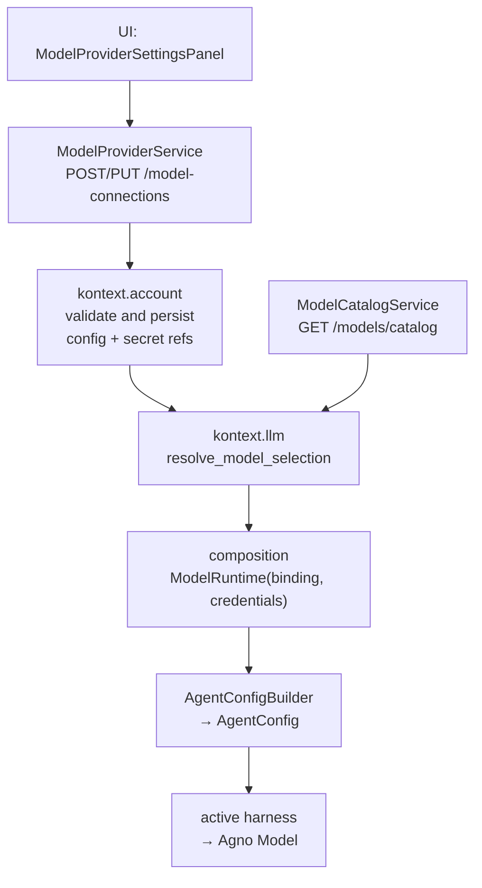

# Model Provider Configuration

This document describes how users configure LLM providers in Kontext, and
the design rules that keep that flow simple and harness-neutral.

## Goals

- Make adding a provider as easy as Cline/OpenCode: pick a provider, paste a
  key (when needed), optionally set a base URL, and name a model.
- Keep the curated catalog as **helpful defaults**, not a gate.
- Keep the model objects harness-neutral so the Agno adapter (or a future
  harness) can materialize them without the domain layer changing.

## What users configure

A connection is described by a small set of inputs:

| Field | When | Notes |
| --- | --- | --- |
| **Provider** | always | `lm_studio`, `ollama`, `ollama_cloud`, `openai`, `anthropic`, `gemini`, `google_vertex`, `bedrock`, `azure_openai`, `openrouter`, `deepseek`, `mistral`, `openai_compatible` |
| **Model** | always | Free text; curated ids are typeahead suggestions |
| **Display name** | always | Friendly label |
| **API key** | when the provider needs it | Not required for local LM Studio/Ollama; optional for Vertex AI (ADC) |
| **Base URL** | local/compatible/Azure providers | Prefilled from the provider definition |
| **AWS region** | Bedrock | |
| **Project / location** | Google Vertex AI | `projectId` required; `location` optional |
| **API version** | Azure OpenAI | Optional; defaults to a recent version |
| **Thinking level** | only when the model supports reasoning | `low`/`medium`/`high` |

Everything else is **server-derived**: `adapterType`, `canonicalModelId`
normalization, the runtime provider model name, secret references, validation
state, and token limits.

The provider-config vocabulary (`ModelProviderConfigField`) is intentionally
small: `endpointBaseUrl`, `region`, `projectId`, `location`, `apiVersion`. The
runtime provider model name is derived from curated metadata (or the canonical
id) and is not a user- or provider-config field. There is no "hosted provider
preset" axis: known OpenAI-compatible hosts (OpenRouter, DeepSeek, Mistral) are
first-class providers, and the generic `openai_compatible` kind is for arbitrary
endpoints.

## Single source of truth

`py/kontext-llm/src/kontext/llm/resources/models/model-provider-definitions.json`
is the one place provider metadata is declared. Each entry carries the adapter
type, display name, default endpoint, config/credential requirements, and the
runtime metadata (default model id, model/API-key/API-base/region/project/
location/API-version env var names).

`kontext.llm.provider_definitions` derives its tables (`SUPPORTED_PROVIDERS`,
`CONNECTION_KIND_TO_ADAPTER_TYPE`, `DEFAULT_MODEL_IDS`, `PROVIDER_MODEL_ENV_VARS`)
from that file at import time, and `kontext.llm.provider_resolution` derives its
display-name, API-key, and API-base lookups the same way — there are no
hand-maintained parallel copies. Adding a provider is a JSON edit plus (when the
adapter type is new) one factory module in the harness.

The loaders **raise** on malformed or duplicate definitions rather than
returning an empty registry, and `py/kontext-llm/tests/test_service.py` asserts
enum validity, uniqueness, and adapter coverage. The duplicate JSON copies that
used to live under `ts/common/src/resources/models/` were removed; the UI reads
provider definitions from the API.

## What we deliberately do NOT expose

These were removed because they are internal tuning knobs, not user decisions:

- `temperature`
- `top_p`
- `max_tokens` (derived from curated model metadata)
- `chainOfThought`, `planner`, `toolPlanning`, `maxSteps`, `extendedThinking`

Only `reasoningEffort` survives as a user control, and only for models whose
curated metadata reports `reasoningSupported`.

## Curated catalog as suggestions

`py/kontext-llm/src/kontext/llm/resources/models/foundation-models.json` is the
curated list. It supplies:

- display name, vendor, description
- `maxTokens` and `reasoningSupported`
- `supportedConnectionKinds` and `providerModelAliases`

It ships as a checked-in snapshot covering the common and current models for
each first-class provider (OpenAI, Anthropic, Google Gemini/Vertex, DeepSeek,
Mistral, Ollama Cloud, Azure OpenAI, AWS Bedrock, OpenRouter, and the local
LM Studio/Ollama placeholders). The catalog ids and token limits are sourced
from the open [models.dev](https://models.dev) catalog; refresh by editing the
file (a reviewable diff), not by fetching at runtime.

It is **advisory**. Resolution rules:

- The UI seeds an `AutoComplete` with matching curated models but accepts any
  id the user types.
- `kontext-account` accepts unknown/custom model ids. It only rejects a model
  that is *in the catalog* but not supported by the chosen provider.
- At runtime, curated models supply metadata (max tokens, reasoning support);
  custom models get conservative defaults.

## Resolution flow

`ResolvedModelConfig` flattens provider config and credential refs into scalar
fields (`provider_model_name`, `endpoint_base_url`, `secret_ref`, `region`,
`project_id`, `location`, `api_version`) rather than carrying the nested objects.
The resolved `reasoning_effort` is applied by
`AgentConfigBuilder` once, with one precedence rule: **persisted binding >
environment override > task-profile default**. The binding is the only model
identity the harness receives; `AgentConfig` carries behaviour knobs only, and
the factory no longer reads `MODEL_PROVIDER`, defaults to `lm_studio`, or reads
the process-global credential store. Composition resolves an app-default
binding when a session has no saved selection and injects the run credentials
as a `ModelRuntime`.

Key modules:

- `ts/schema/src/core/domains/infrastructure/model-catalog.ts` — the contract.
- `ts/chat/src/components/ModelProviderSettingsPanel.tsx` — the single-form UI.
- `ts/chat/src/components/modelProviderFormConfig.ts` — pure form helpers.
- `py/kontext-llm/src/kontext/llm/provider_definitions.py` — provider
  definitions plus the tables derived from them (adapter mapping, default model
  ids, env vars).
- `py/kontext-llm/src/kontext/llm/provider_resolution.py` — provider/credential
  resolution helpers (base URL, API key, reasoning kwargs) used by the harness.
- `py/kontext-common/src/kontext/common/contracts/resolved_model_config.py` —
  `ResolvedModelConfig` (shared contract type).
- `py/kontext-llm/src/kontext/llm/model_selection.py` — selection -> resolved
  binding.
- `py/kontext-llm/src/kontext/llm/model_connection_store.py` — the
  `ModelConnectionStore` port and composition registration seam.
- `py/kontext-account/src/kontext/account/model_connections.py` — persistence +
  validation.
- `py/kontext-harness-agno/src/kontext/harness/agno/providers/` — one small factory module per
  provider, selected through the connection-kind registry; `models.py` is a thin
  dispatcher.

## Design rules

1. **One form, no editor tabs.** Adding a provider is a single vertical form
   grouped by heading (basics / availability / authentication). Error jumping
   between tabs is unnecessary when everything is visible.
2. **Server derives, client sends intent.** The client sends provider, model id,
   optional key/base URL/region/project/location/API version, reasoning effort,
   and flags. The server owns adapter type, runtime model name, and secret
   handling.
3. **No sampling knobs.** If a knob is not meaningful to a non-expert user, do
   not surface it. Token limits come from the model catalog.
4. **Curated is a hint, never a wall.** New models must not require a code
   change to use.
5. **Harness-neutral contracts.** `ResolvedModelConfig` carries no SDK types
   and no secret values; the harness adapter builds the native model.
6. **One source of truth per fact.** Provider metadata lives only in
   `model-provider-definitions.json`; runtime tables and lookups are derived.
7. **One factory per provider.** Each provider's native model construction lives
   in its own module, so adding a provider is additive and reviewable.

## Adding a new model

Add an entry to `foundation-models.json` (regenerating is not required for it to
be usable). To have it appear as a curated suggestion, include
`canonicalModelId`, `name`, `vendor`, `adapterType`, `supportedConnectionKinds`,
and optionally `providerModelAliases`, `maxTokens`, `reasoningSupported`.

## Adding a new provider

1. Add a connection kind to `ModelConnectionKindSchema` (and an adapter type if
   the wire protocol is new) in
   `ts/schema/src/core/domains/infrastructure/model-catalog.ts`, then regenerate
   models and SDK clients.
2. Add a `ModelProviderDefinition` entry to `model-provider-definitions.json`
   (adapter, config/credential requirements, default model id, env var names).
3. Add a provider factory module under
   `py/kontext-harness-agno/src/kontext/harness/agno/providers/` and register it in that
   package's `PROVIDER_FACTORIES` map.
4. Add form copy (description + placeholders) in
   `ts/chat/src/components/modelProviderFormConfig.ts`.
5. No changes to the resolver, account layer, or unrelated harness code.
