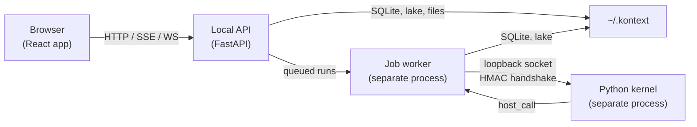
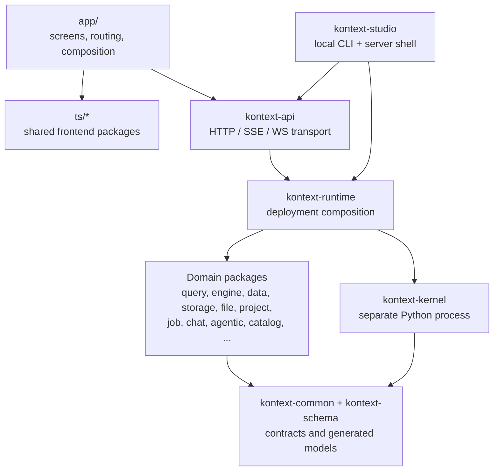

# Architecture overview

Kontext Studio is a local-first, single-user conversational analytics workspace. This page is
the system map: the processes, layers, data flow, and technology choices. The
detailed rules live in the linked canonical pages.

## System context

In development the React app runs on Vite as a second process; in a local
release the API serves the built app from `app/dist`. The API remains the only
API entry point; Vite serves only the app in development.

## Layers

| Layer | Responsibility | Canonical detail |
| --- | --- | --- |
| `app/` | Screens, routing metadata, providers, and composition | [App README](../../app/README.md) |
| `ts/*` | Shared React state, services, domain components, schema contracts, theme, and host client | `ts/*/package.json`, [AGENTS.md](../../AGENTS.md) |
| `kontext-api` | Routers, dependencies, request/auth context, thin application services | [Python package boundaries](python-package-boundaries.md) |
| `kontext-studio` | Installed local CLI/server composition, process supervision, developer workflows | [Local operations](local-operations.md) |
| `kontext-runtime` | Provider/backend selection and deployment-profile composition | [Python package boundaries](python-package-boundaries.md) |
| Domain packages | Query, compute, persistence, storage, files, projects, jobs, chat, agents, catalog, knowledge | [Python package boundaries](python-package-boundaries.md) |
| `kontext-common` / `kontext-schema` | Protocols, shared contracts, generated Pydantic models | [Contract pipeline](generated-code.md) |
| `kontext-kernel` | Separate-process Python execution, wire protocol, manager/pool | [Python package boundaries](python-package-boundaries.md) |

The import graph is acyclic and enforced by
`py/kontext-common/tests/test_architecture_boundaries.py`. Shared TypeScript
packages are consumed through their public entry points; only `app/src` uses the
`@/` alias.

## Processes and runtime

| Process | Role |
| --- | --- |
| API (uvicorn/FastAPI) | Serves the HTTP/SSE/WS contract, and the built React app in local releases. |
| Job worker | Claims queued runs from SQLite, owns kernels, and writes results/events. It never runs job code in the API process. |
| Python kernel | Executes user/agent Python in a child process; a stdlib-only harness talks over four loopback sockets with an HMAC handshake and connection file written `0600`. |
| Vite (development) | Serves the React app separately; the API URL is injected into `window.ENV`. |

Local startup runs migrations and seeding under `local-init.lock`, so the API
and worker cannot race. The launch-token, Host/Origin, JWT, and cookie chain is
described in the [security model](security-model.md).

## Core flows

- **UI request / query**: React route → API router → `require_project_authorization`
  → application service → query runtime provider → DuckDB engine → lake/storage.
  The query engine never imports query/catalog orchestration.
- **Agent chat**: API → `kontext-chat` → `kontext-agentic` blueprints → harness
  adapter (`kontext-harness-agno`) → domain tools (SQL, chart, notebook, Python)
  → query/job services. Tool results cross the boundary through the shared
  schema. See [AI architecture](../ai/ai-architecture.md).
- **Jobs**: API creates a durable run → worker claims it → kernel executes it →
  platform capabilities come back through `host_call` → results and events are
  persisted. Cancellation is carried by the run's persisted status, not an
  in-process signal.
- **Files**: upload → storage provider → project file records; browser-native
  previews/downloads use the HttpOnly local session cookie.

## Data and storage

| Store | Contents |
| --- | --- |
| SQLite (`~/.kontext/kontext.db`) | Projects, files, chats, query sessions, jobs/runs, token usage, model connections. |
| Lake/storage (`KONTEXT_LAKE_PATH`, default `~/.kontext`) | Uploaded files, artifacts, and managed storage. |
| DuckDB | Analytical sessions; persistent session files or in-memory engines. |
| Catalog index | LanceDB + embeddings for semantic schema/search retrieval. |
| OKF bundles | Markdown/YAML knowledge documents projected into the knowledge contract. |

Paths and limits are configuration, not constants; see the
[environment reference](environment.md) and the
[security model](security-model.md) for the path policy.

## Technology stack

| Area | Choices |
| --- | --- |
| Frontend | React, TypeScript, Vite, Ant Design, Zustand, TanStack Query, Zod, `openapi-fetch`. |
| API and contracts | FastAPI, Pydantic v2, OpenAPI, generated TypeScript types and Python models. |
| Persistence and analytics | SQLAlchemy, SQLite, DuckDB, LanceDB, fastembed. |
| Auth | Local JWTs via PyJWT; the local profile and session cookie; JWT seam for hosted deployments. |
| AI | Harness-neutral `kontext-agent` contracts, `kontext-agentic` blueprints/tools, Agno via `kontext-harness-agno`. |
| Execution | Separate-process kernel with a stdlib-only harness, loopback wire protocol, resource limits. |
| Observability | Structured logging and optional OpenTelemetry OTLP export. |
| Tooling | pnpm + uv workspaces, pytest, pyright, ruff, ESLint, Prettier, pre-commit. |
| Docs | Playwright capture for the user guide; Astro/Starlight for the docs site. |

Exact dependency ranges live in the package manifests; do not restate them here.

## Deployment profiles

- **Local** (implemented): SQLite, local filesystem, local identity, and the
  kernel execution topology.
- **Cloud** (contract placeholder): external relational/storage/queue/identity
  backends behind the existing seams; the same kernel topology. No concrete
  cloud backend ships in this repository.

Profile selection and process topology are separate axes; see
[Python package boundaries](python-package-boundaries.md#deployment-profiles).

## Where to read more

| Topic | Page |
| --- | --- |
| Package matrix, import rules, runtime/engine/execution placement | [Python package boundaries](python-package-boundaries.md) |
| Agents, teams, tools, SQL validation | [AI architecture](../ai/ai-architecture.md) |
| Harness contracts and plugin selection | [Harness abstraction](../ai/harness-abstraction.md), [Harness strategy](../ai/harness-strategy.md) |
| Model providers and credentials | [Model provider configuration](../ai/model-provider-configuration.md) |
| Notebook document model and execution | [Notebook system](../notebook/notebook-system.md) |
| Trust boundaries and residual risk | [Security model](security-model.md) |
| Claims, roles, feature gates | [Authorization and permissions](authorization.md) |
| Running, recovery, and troubleshooting | [Local operations](local-operations.md) |
| Environment variables and ownership | [Environment reference](environment.md) |
| OpenAPI and generated artifacts | [OpenAPI workflow](openapi-workflow.md), [Generated code](generated-code.md) |
| Release artifacts | [Releasing](releasing.md) |
