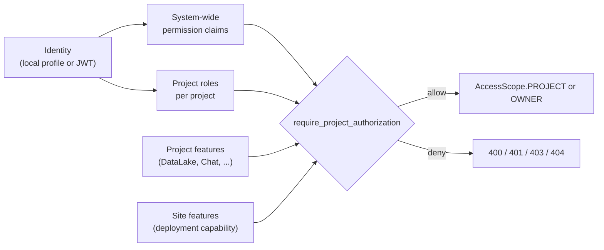

# Authorization and permissions

Kontext authorizes at the server. The frontend mirrors the same decisions to
hide unavailable actions, but it is not the boundary. This page describes the
claim/role model, project scoping, feature gates, and where to add a new
permission.

## Model at a glance



There are two independent authorization axes plus a deployment axis:

- **Permission claims** are system-wide strings on the user
  (`permission_claims`), e.g. `chatsessions.read`.
- **Project roles** are per-project (`project_roles`): `owner`, `admin`,
  `contributor`, `reader`. Project roles map to permissions through a shared
  table.
- **Features** are capability gates: `ProjectFeature` per project and
  `SiteFeature` per deployment. They are not per-user permissions.

## Permission claims

Claims are lowercase strings shared with the API contract. The canonical values
live in [`kontext.auth.permissions`](../../py/kontext-auth/src/kontext/auth/permissions.py):

| Group | Claims |
| --- | --- |
| Projects | `projects.create`, `projects.read`, `projects.update`, `projects.delete` |
| Files/resources | `resources.create`, `resources.read`, `resources.update`, `resources.delete` |
| Jobs | `jobs.create`, `jobs.read`, `jobs.update`, `jobs.delete`, `jobs.execute` |
| Query sessions | `querysessions.create`, `querysessions.read`, `querysessions.update`, `querysessions.delete`, `querysessions.execute` |
| Chat sessions | `chatsessions.create`, `chatsessions.read`, `chatsessions.update`, `chatsessions.delete` |
| Events | `events.create`, `events.read` |

Files use `resources.*` rather than `files.*` for compatibility with existing
tokens and the former .NET API claims.

## Project roles

| Role | Typical capability |
| --- | --- |
| `owner` | Full project control, including delete and project administration. |
| `admin` | Manage project settings, jobs, and read/write content. |
| `contributor` | Create and edit content; cannot manage the project or jobs. |
| `reader` | Read-only access to project content. |

Role-to-permission mapping
([`project-permission-to-roles.json`](../../py/kontext-auth/src/kontext/auth/resources/security/project-permission-to-roles.json)):

| Permission | Roles |
| --- | --- |
| `projects.read` | owner, admin, contributor, reader |
| `projects.update` | owner, admin |
| `projects.delete` | owner |
| `resources.create` | owner, admin, contributor |
| `resources.read` | owner, admin, contributor, reader |
| `resources.update` | owner, admin, contributor |
| `resources.delete` | owner, admin, contributor |
| `jobs.create` | owner, admin, contributor |
| `jobs.read`, `jobs.update`, `jobs.delete`, `jobs.execute` | owner, admin |
| `querysessions.*` | owner, admin, contributor |
| `chatsessions.*` | owner, admin, contributor |
| `events.read` | owner, admin |

`projects.create` and `events.create` are system-wide claims only; they have no
project-role mapping. A missing mapping means only the claim grants the
permission.

## Effective permission check

[`check_user_permissions`](../../py/kontext-api/src/kontext/api/dependencies/auth.py)
returns true when **any** of the required permissions is satisfied by either:

1. the user's system-wide `permission_claims`, or
2. a project role listed for that permission in the mapping.

In local mode the profile carries the `local_admin` role and every claim, so
local authorizations succeed regardless of project role. In a hosted
deployment, claims are system-wide while project roles provide the
project-scoped path.

## Request authorization

Every project-scoped router declares permissions and/or project features:

```python
@router.get(
    "...",
    dependencies=[
        require_project_authorization(
            required_permissions=[ProjectPermissions.READ],
            required_features=[ProjectFeature.DATALAKE],
        )
    ],
)
```

`require_project_authorization`:

- builds an `AuthContext` with the user, project, resource, and an
  `AccessScope` (`PROJECT` or `OWNER`);
- resolves the project from the path, query, body, or headers
  (`extract_project_id`);
- returns `400` when a project is required but absent, `401` when no user is
  resolved, `404` when the project or a required site feature is absent, and
  `403` when permissions or project features are insufficient;
- supports `allow_owner=True`: if the user lacks project permissions but owns
  the specific resource, access is restricted to `AccessScope.OWNER`; for list
  operations without a resource it still narrows the scope to owner-filtered
  results;
- runs `resource_getter` after the project is attached, so resource-level checks
  see the project context.

`create_auth_dependency` is the lighter variant for routes that do not need the
full project/resource pipeline.

## Feature gates

| Gate | Scope | Where | Failure |
| --- | --- | --- | --- |
| `SiteFeature` | Deployment capability (which surfaces this build exposes) | `require_site_feature(...)` on a router | `404` so a disabled surface looks non-existent. |
| `ProjectFeature` | Per-project capability (`Documentation`, `DataLake`, `Search`, `Chat`) | `required_features=[...]` in `require_project_authorization` | `403` listing the missing features. |

Site features are advertised by the active runtime profile and returned in
`SiteConfigResponse`; the frontend uses the same list for navigation and route
visibility. Local mode advertises `local-mode`, `model-connections`, and
`python-environment`. Add or remove features with `KONTEXT_SITE_FEATURES` /
`KONTEXT_DISABLED_SITE_FEATURES` (disable wins).

`SiteFeature.LOCAL_MODE` is the server-advertised capability. The frontend also
has an early `KONTEXT_LOCAL_MODE` environment flag injected into `window.ENV` for
auth rehydration; once site config is available, code should use the site
feature.

## Permission map override

`KONTEXT_PROJECT_PERMISSION_MAP_PATH` replaces the bundled JSON map with a file
you control. The map is loaded once at import into `PERMISSION_TO_ROLES`;
changes require a server restart. An invalid or empty map raises at startup, so
a broken override fails closed rather than silently dropping the mapping.

The override is security-sensitive: it changes which project roles can perform
which operations. Keep the file readable only by the account running the server.

## Local-mode specifics

- The seeded or user-created profile gets `roles: ["local_admin"]` and the full
  claim set; project roles come from the local project records (the project
  owner gets `owner`).
- The local API accepts a Bearer token or the HttpOnly session cookie; there is
  no ambient profile fallback.
- First-run setup and the placeholder-profile rules are described in the
  [security model](security-model.md).
- `/host/projects` and `/host/auth/me` require a resolved user; `/host/config`
  and `/host/culture` are static and public.

## Frontend mirror

`@kontext-tech/auth` exposes `PermissionContext`, `evaluatePermission`, and
route guards. They evaluate the same claims, roles, and features to hide
actions, disable navigation, and render access-denied states. Treat these as
UX: every route still enforces the same rule server-side.

## Adding a permission or feature

1. Add the claim to the canonical constants in
   [`kontext.auth.permissions`](../../py/kontext-auth/src/kontext/auth/permissions.py)
   (and the TypeScript `permissionClaims` constant if the UI needs it).
2. Add the project-role mapping to `project-permission-to-roles.json` if the
   permission should be role-derived; otherwise document that it is
   system-wide only.
3. Declare it on the route with `required_permissions` or
   `required_features`, and add the corresponding schema/OpenAPI field if it
   crosses the HTTP boundary.
4. Update the frontend evaluator/route metadata and add API tests for allow and
   deny paths.
5. If it is a deployment capability rather than a user permission, add a
   `SiteFeature` value, advertise it from the runtime profile, and gate the
   router with `require_site_feature`.

## Related documentation

- [Security model](security-model.md) — trust boundaries and credential chain.
- [Environment reference](environment.md) — feature and permission-map env vars.
- [Python package boundaries](python-package-boundaries.md) — the auth package's
  responsibilities.
