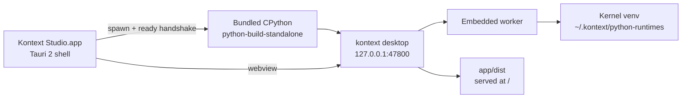

# Desktop builds

The desktop app is a Tauri 2 shell around the existing local server. It bundles
CPython and every Python package the app needs, so a macOS user installs a DMG
and opens it without a Python toolchain.

## Architecture



- The webview navigates to the server's own origin, so the launch token,
  HttpOnly cookie, Host/Origin guard, SSE, and SPA fallback are unchanged.
- The shell reads one `@@KONTEXT_READY@@{…}` line from the server's stdout and
  navigates the window to the launch URL.
- The server exits when the shell disappears (stdin EOF or parent PID), and the
  worker exits when the server disappears.
- Data stays in `~/.kontext`; logs go to `~/Library/Logs/Kontext Studio`.

## Layout

```text
desktop/
  runtime.lock.json        # pinned python-build-standalone assets
  scripts/assemble.py      # runtime + wheelhouse assembly
  scripts/ensure-resources.mjs
  scripts/make-icon.py
  splash/index.html
  src-tauri/
    src/                   # main, backend, downloads, menu, navigation
    capabilities/, permissions/
    icons/
    resources/             # generated, gitignored
```

## Prerequisites

- Node and `pnpm` at the versions in the root `package.json`.
- `uv` and Python 3.12.
- Rust stable with `rustfmt` and `clippy`.
- macOS: Xcode command-line tools.

## Build

```bash
pnpm install
pnpm run build:shared
pnpm run desktop:assemble
pnpm run desktop:build
```

`desktop:assemble` downloads the pinned CPython, installs the desktop wheel into
that interpreter's own `site-packages`, and downloads the kernel wheelhouse.
`desktop:build` produces the `.app` under
`desktop/src-tauri/target/release/bundle/macos/` and
`dist/Kontext-Studio-<version>-macOS-<arch>.dmg`.

The DMG is created by `desktop/scripts/make-dmg.sh` with `hdiutil`, not by
Tauri's built-in DMG bundler. Tauri styles its DMG window through Finder, which
times out in headless CI sessions. The plain DMG still contains the app and an
`Applications` shortcut for drag-to-install.

For UI iteration, `pnpm run desktop:dev` starts the Tauri dev window. The shell
still expects an assembled `desktop/src-tauri/resources/` runtime.

### Assembly options

`desktop/scripts/assemble.py` accepts:

| Flag | Meaning |
| --- | --- |
| `--arch arm64\|x64\|win-x64` | Target architecture; defaults to the host |
| `--wheel PATH` | Reuse an existing desktop wheel |
| `--skip-app-build` | Reuse the current `app/dist` |
| `--skip-wheelhouse` | Skip the offline kernel package download |
| `--skip-smoke` | Skip the import smoke test |

Cross-arch builds must run on a matching macOS runner; `uv pip install` needs to
run the target interpreter.

## Dependency profile

The desktop wheel is built with `--profile desktop`
(`scripts/uv/build-kontext-studio-wheel.py`). It drops these external deps:

`psycopg`, `psycopg-binary`, `pymysql`, `pyodbc`, `oracledb`, `teradatasql`,
`teradatasqlalchemy`.

The code paths remain, but those warehouse connectors are unavailable in the
desktop build. `pyodbc` needs a system unixODBC install, and `teradatasql` is a
large proprietary driver. The PyPI wheel keeps every dependency.

## Offline kernel environment

The kernel venv is created from the bundled interpreter on first use.
`KONTEXT_PYTHON_RUNTIME_WHEELHOUSE` points at
`Contents/Resources/wheelhouse`; `python_environment.py` then installs with
`--no-index --find-links` and skips the pip upgrade step.

`desktop/scripts/assemble.py` asks the installed runtime for
`default_runtime_packages()` and passes those specs to `pip download`. The
wheelhouse is therefore derived from the exact code that ships in the app;
there is no separate list to keep in sync.

## CI and releases

`.github/workflows/desktop.yml` builds Apple Silicon on `macos-15`. It checks
out the `v<version>` tag, assembles the runtime, builds the app, verifies the
signature and the bundled server, and uploads
`Kontext-Studio-<version>-macOS-arm64.dmg`.

Intel is blocked until `lancedb` publishes a macOS x86_64 wheel: no 0.38+
release has one, and the project requires 0.38 or newer. The x64 assembly path
stays available (`--arch x64`) for when that changes; re-add the
`macos-15-intel` matrix entry at the same time.

Push-triggered releases dispatch it from `release.yml` after the GitHub Release
exists. A manual dispatch is the retry path:

```bash
gh workflow run desktop.yml -f version=0.262.0 -f upload=true
```

The release job downloads the DMG, writes `SHA256SUMS-desktop.txt`, and attaches
both assets to `v<version>`. The Python wheel and its `SHA256SUMS` stay
untouched.

Pull requests that touch `desktop/`, the wheel builder, the labs/runtime
packages, or `ts/file/` run Rust formatting, clippy, and the frontend bridge
lint on `macos-15`.

## Signing

Version 1 is ad-hoc signed (`signingIdentity: "-"`) and not notarized. That is
a limited early-access beta: macOS requires System Settings → Privacy &
Security → Open Anyway, or `xattr -dr com.apple.quarantine`.

When an Apple Developer Program membership is available:

1. Create a Developer ID Application certificate.
2. Store `APPLE_CERTIFICATE`, `APPLE_CERTIFICATE_PASSWORD`,
   `APPLE_SIGNING_IDENTITY`, `APPLE_ID`, `APPLE_TEAM_ID`, and
   `APPLE_APP_SPECIFIC_PASSWORD` as repository secrets.
3. Set `hardenedRuntime: true`, apply `Entitlements.plist`, and let Tauri sign
   and notarize.
4. Verify with `codesign --verify --deep --strict` and `spctl -a -vv`, then
   remove the Gatekeeper workaround from the user guide.

The committed entitlements cover JIT, unsigned executable memory, library
validation, and network access; the bundled PBS binaries and extensions need
them.

## Verification

- `uv run --package kontext-studio pytest py/kontext-labs/tests`
- `uv run --package kontext-runtime pytest py/kontext-runtime/tests`
- `pnpm run desktop:check`
- `cargo test --manifest-path desktop/src-tauri/Cargo.toml`
- Launch the assembled app on a Mac without Python: setup, create a project,
  upload a CSV, run SQL, chart it, chat, run a Python block, download a file,
  open an external link, quit, and confirm no `kontext.labs` process remains.

## Troubleshooting

- **`cargo check` fails with "resource path does not exist"** — run
  `node desktop/scripts/ensure-resources.mjs` first.
- **The app shows the splash forever** — open Help → Open Logs and inspect
  `desktop.log`. The server's ready line and stderr are written there.
- **The server port is occupied** — the app prefers `47800` and falls back to
  an ephemeral port. A fallback changes the webview origin, so UI preferences
  stored in `localStorage` may reset.
- **A blob download does nothing** — WKWebView does not honor `<a download>`
  for `blob:` URLs. The shell injects `window.__KONTEXT_DESKTOP__.saveBlob` and
  `ts/file` routes downloads through it.
- **DMG creation fails inside Finder** — the build uses `hdiutil` through
  `desktop/scripts/make-dmg.sh`; do not switch `bundle.targets` back to `dmg`
  for headless builds.
