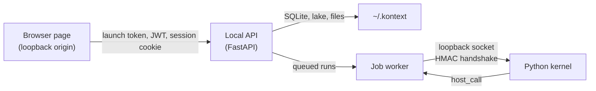

# Security and trust model

This page explains what Kontext's local security controls protect, how the
pieces fit together, and what remains outside the boundary. It is the canonical
description for contributors and operators; [SECURITY.md](../../SECURITY.md)
covers vulnerability disclosure, and the
[environment reference](environment.md) lists the individual settings.

## Trust boundaries

The local deployment has four trust levels:

1. **The operating-system user** is trusted. A same-user process can read the
   environment, `~/.kontext`, and the token files. The security model does not
   defend against a compromised account or malicious same-user software.
2. **Browser pages are untrusted**, including pages that resolve to
   `127.0.0.1`. They must present a credential the launcher gave the real UI.
3. **The loopback network is not a security boundary by itself.** Host and
   Origin validation exist because a browser page can reach loopback through
   DNS rebinding.
4. **The kernel is less trusted than the supervisor.** It runs in a separate
   process with file/import confinement and resource limits, but as the same
   OS user and without an OS-level sandbox.

## Browser boundary

The local API validates every HTTP and WebSocket request:

- **Host allowlist.** Only loopback names (`127.0.0.1`, `localhost`, `::1`) and
  explicitly configured names pass. `kontext serve` adds this machine's
  interface addresses for wildcard or non-loopback binds. A DNS-rebinding page
  sends its own hostname as `Host`, so it is rejected.
- **Origin check.** Requests with a foreign `Origin` are rejected. This stops
  cross-site form/fetch posts before CORS is involved.
- **CORS.** CORS remains a separate allowlist with credentials enabled. It is
  not the primary defense; a same-origin rebound page never triggers CORS.

`testserver` is deliberately **not** part of the production allowlist; tests
widen the lookup themselves.

Binding to a non-loopback address is supported for LAN use but has no TLS. The
CLI warns and adds only the machine's interface addresses to the allowlist.
Reverse proxies must add their public hostname through
`KONTEXT_ALLOWED_HOSTS`.

## Credential chain

### Launch token

The launch token is the proof that a browser was opened by the local launcher
rather than by a page that reached loopback on its own.

- Generated per run (`secrets.token_urlsafe(32)`) by `kontext serve` or the
  dev launcher. The worker inherits it through the environment.
- Printed in the URL fragment (`/#token=...`), which the app reads and then
  strips from the address bar. The fragment is never sent to the server or its
  access logs.
- Persisted owner-only to `~/.kontext/runtime/launch.token` and
  `launch-<port>.token`, so a lost URL can be recovered.
- Required for `GET /host/auth/bootstrap`, `POST /host/auth/refresh`, and
  `POST /setup`. A valid local session cookie is also accepted so a new tab or
  bookmark can re-bootstrap.
- Restarting the server rotates the launch token. Previously issued JWTs
  remain valid until they expire or the signing key is rotated.

The gate is tied to the app composition (`app.state.local_auth_required`), not
to an environment variable. A local app cannot lose the gate by inheriting
`KONTEXT_LOCAL_MODE=false`; the local composition also forces local mode.

### Local JWTs and session cookie

Once the launch token is accepted, the server mints HS256 tokens:

- Signing key: `~/.kontext/local.key`, created `0600`; the data directory is
  `0700`.
- Issuer `kontext-local`, audience `kontext-platform`.
- Access token 30 days, refresh token 365 days by default.
- The bootstrap/setup/refresh response also sets `kontext_local_session`, an
  HttpOnly, `SameSite=Strict`, path `/` cookie. It lets browser-native requests
  (``, notebook embeds, direct download links) identify the user without an
  `Authorization` header. It is a session cookie; a new browser session needs
  the printed URL again.
- Data routes accept either `Authorization: Bearer <jwt>` or the session
  cookie. There is no ambient-profile fallback for unauthenticated requests.

Local JWTs are stateless. Logging out deletes the cookie but does not revoke an
already-issued token. To invalidate all local sessions, stop the server, delete
`~/.kontext/local.key`, and restart; every existing token then fails
verification. If `KONTEXT_JWT_SECRET_KEY` or `JWT_SECRET_KEY` is set, rotate that
value instead — the generated `local.key` is not in use.

### First run and setup

- Fresh workspace: the seeded placeholder profile is unauthenticated, so the UI
  routes to `/setup`. Setup requires the launch token and creates the profile.
- Workspace with content: setup is blocked (it must not repurpose an existing
  owner), so the seeded placeholder is authenticated instead. This prevents a
  login/setup redirect loop.
- `KONTEXT_LOCAL_CONSOLE_AUTO_AUTH` is a test/automation override that skips the
  first-run prompt. It does **not** bypass the launch token.

## Authorization

Server-side authorization is authoritative. The local profile receives the
`local_admin` role and the full permission-claim set; projects grant the owner
role to their owner. See [Authorization and permissions](authorization.md) for
the claim/role model, project scoping, feature gates, and the permission-map
override.

## Filesystem and execution confinement

- File reads and writes are confined to the managed storage directory plus
  `KONTEXT_ALLOWED_PATHS` (OS path separator between entries). The managed
  storage path is always allowed.
- The kernel child receives the computed open roots
  (`KONTEXT_OPEN_ROOTS`) and module allow/blocklists
  (`KONTEXT_WHITELISTED_MODULES`, `KONTEXT_BLACKLISTED_MODULES`). These are
  supervisor-provided; do not set them by hand.
- The kernel is a separate process with best-effort POSIX `rlimit`s (address
  space, CPU time, file size, open files, processes) or a Windows Job Object.
  It has no snapshot/restore; a dead session starts a fresh namespace.
- The supervisor authenticates the kernel connection with an HMAC handshake
  over a loopback socket and publishes the connection file `0600`.
- Cancellation crosses the process boundary through the persisted run status,
  not an in-process signal.

The kernel is not an OS sandbox. It runs as the local user; a compromised or
malicious agent-authored cell can reach anything that user can reach, subject
to the path and import policy.

## Secrets

- `.env.local` is gitignored; never commit provider keys, JWT secrets, access
  tokens, or cookies. `.env.example` contains placeholders only.
- The data directory holds `local.key`, the SQLite database (including model
  connection credentials), storage, and runtime tokens. Treat it as sensitive.
- `~/.kontext/local.key`, `launch.token`, and `launch-<port>.token` are created
  owner-only. The launch URL itself contains the token, so avoid pasting it into
  shared logs or screenshots.
- Structured logs do not print provider keys or tokens by default. Avoid
  `KONTEXT_LOG_LEVEL=DEBUG` in shared environments.

## Threat matrix

| Threat | Mitigation | Residual risk |
| --- | --- | --- |
| Malicious page reaches loopback via DNS rebinding | Host allowlist plus Origin check | A same-user process can still reach the API; it does not need a browser. |
| Cross-site POST against the local API | Origin check, `SameSite=Strict` cookie, launch-token/JWT requirement | A browser extension with host permissions is outside the model. |
| Another local user reads secrets | Data directory `0700`, secret files `0600` | A compromised OS account or same-user malware can read them. |
| Stolen JWT or session cookie | HttpOnly cookie, strict same-site, 30-day access TTL | No per-token revocation; rotate `local.key` to invalidate all. |
| Path traversal or reading arbitrary files | Managed storage plus `KONTEXT_ALLOWED_PATHS`, kernel open roots | Over-broad allowed paths widen the boundary. |
| Arbitrary code in an agent cell | Separate kernel process, import policy, resource limits | Runs as the local user; not an OS sandbox. |
| Provider key exfiltration | Local secret storage and permissions | A malicious same-user process can read them. |
| Telemetry egress | OTLP endpoint is opt-in and operator-set | A misconfigured endpoint sends traces elsewhere. |
| LAN access without TLS | Non-loopback binds are opt-in and warned; interface allowlist | Network observers can read plaintext HTTP. |

## Out of scope

- A compromised operating-system account or malicious same-user software.
- Browser extensions with page or cookie access.
- An OS-level sandbox for the kernel (only process isolation and limits).
- The hosted/cloud profile, which is a contract placeholder in this repository.

## Related documentation

- [Environment reference](environment.md) — variable defaults and ownership.
- [Authorization and permissions](authorization.md) — claims, roles, gates.
- [Python package boundaries](python-package-boundaries.md) — kernel model.
- [SECURITY.md](../../SECURITY.md) — vulnerability disclosure.
