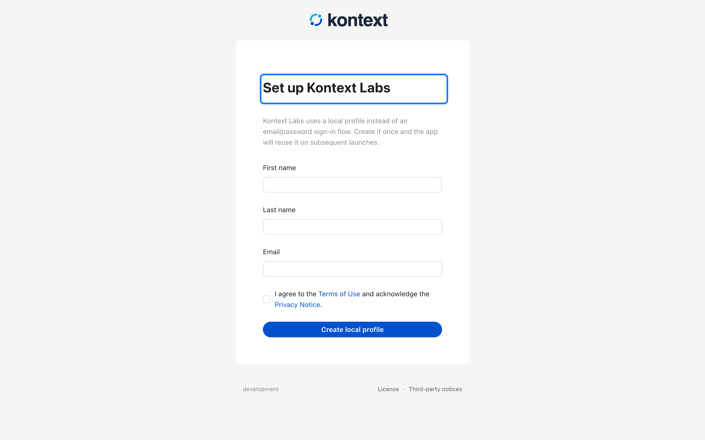
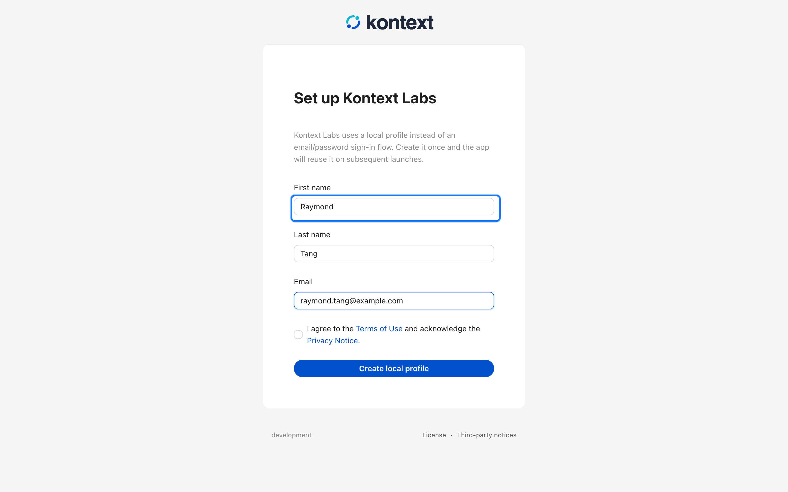
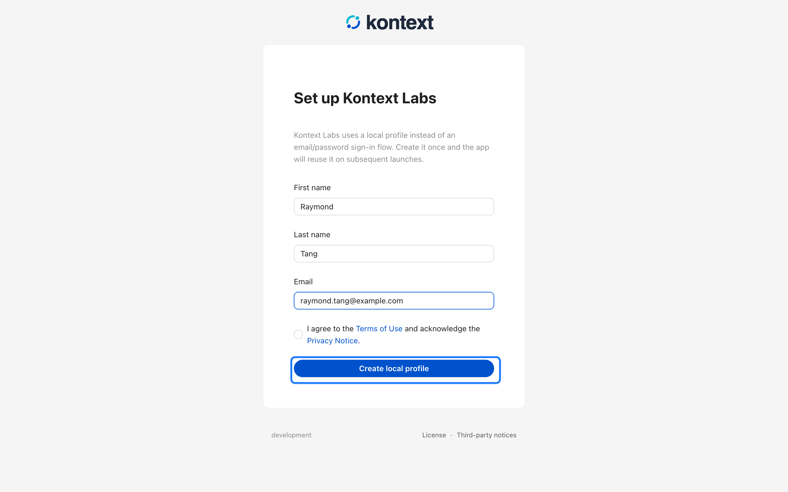
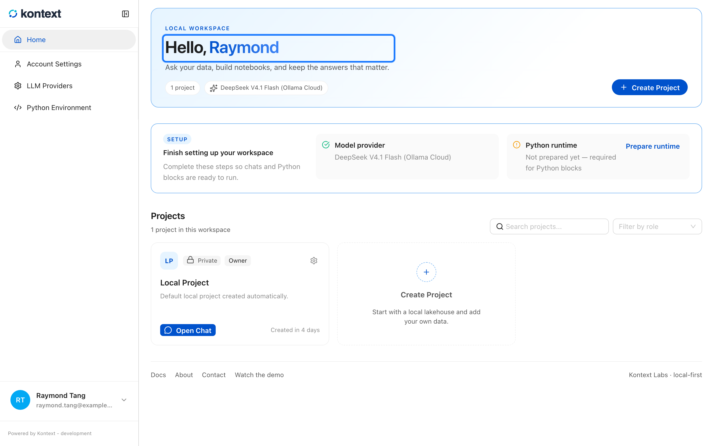

# Install and start Kontext Studio

Kontext Studio runs on your own machine. The local server, the data engine, and
the web app all start together, and everything you create stays in a workspace
directory on disk.

## Before you start

You need Python 3.12 or newer. Install with `uv`, `pipx`, or `pip` in a virtual
environment. [Install `uv`](https://docs.astral.sh/uv/) if you prefer it.

## Install

### With uv (recommended)

```bash
uv tool install kontext-studio
```

### With pipx

```bash
pipx install kontext-studio
```

### With pip in a virtual environment

```bash
python -m venv .venv
source .venv/bin/activate   # Windows: .venv\Scripts\activate
pip install kontext-studio
```

To pin a specific release, add the version number to any install command:

```bash
uv tool install "kontext-studio==0.261.0"
pipx install "kontext-studio==0.261.0"
pip install "kontext-studio==0.261.0"
```

To upgrade later:

```bash
uv tool upgrade kontext-studio
pipx upgrade kontext-studio
pip install --upgrade kontext-studio
```

> Pip installs into the active Python environment; use a virtual environment.
> If the server reports an unsupported SQLite version, use a Python build with
> SQLite 3.51.2 or newer, or uv's managed Python.

## Start the server

Run the server from the directory that should hold your workspace:

```bash
kontext serve
```

The first start creates a workspace in `~/.kontext/` and prints the URL to open.
Kontext seeds a placeholder profile called **Local Admin** and one project
called **Local Project**, so you can start working immediately. If the server
reports a missing launch token, a Host/Origin error, or a port conflict, see
[local operations and troubleshooting](../development/local-operations.md).

To open the browser automatically:

```bash
kontext serve --open
```

Use `--host`, `--port`, or `--lake-path` to bind a different address, change
the port, or keep the workspace somewhere other than `.kontext/`.

## Replace the placeholder profile

The placeholder profile is enough to get started, but it is worth replacing
before you add data. The setup page is available at `/setup` on the same address
as the app, for example <http://localhost:8000/setup>.

<!-- docs:capture 01-install-and-start hash=2b1d05217f0f -->
1. Kontext starts with a placeholder profile. Open `/setup` before you add any data to replace it with your own name and email.
   
2. Enter a first name, an optional last name, and an email address.
   
3. Select **Create local profile**. Kontext stores the profile on this machine and signs you in.
   
4. Kontext opens your workspace with one project and the local profile you created.
   
<!-- /docs:capture -->

## Connect a model provider

Kontext Studio does not bundle a model. After signing in, open **LLM Providers** and
add a local or cloud provider, then choose the default model for your work. See
[Connect a model provider](10-connect-a-model-provider.md) for the supported
providers and settings.

## CLI commands

Most work happens in the browser, but `kontext-studio` also exposes the local
workspace from the terminal:

| Command | Description |
| --- | --- |
| `kontext serve` | Start the local server and UI |
| `kontext project list` | List projects in the local workspace |
| `kontext project create <name>` | Create a project |
| `kontext project import <files…>` | Import data files into a project |
| `kontext job list` | List available job types |
| `kontext job run <type>` | Run a job synchronously |

`project import` accepts CSV, Parquet, JSON, and other data files. Pass
`--project` to target a project other than the first one, and `--subdir` to
choose where the files land under the project's data directory.

## Supported platforms

| Platform | Architecture |
| --- | --- |
| macOS | arm64, x86_64 |
| Linux | x86_64 |
| Windows | x86_64 |

Python 3.12 or newer is required.
