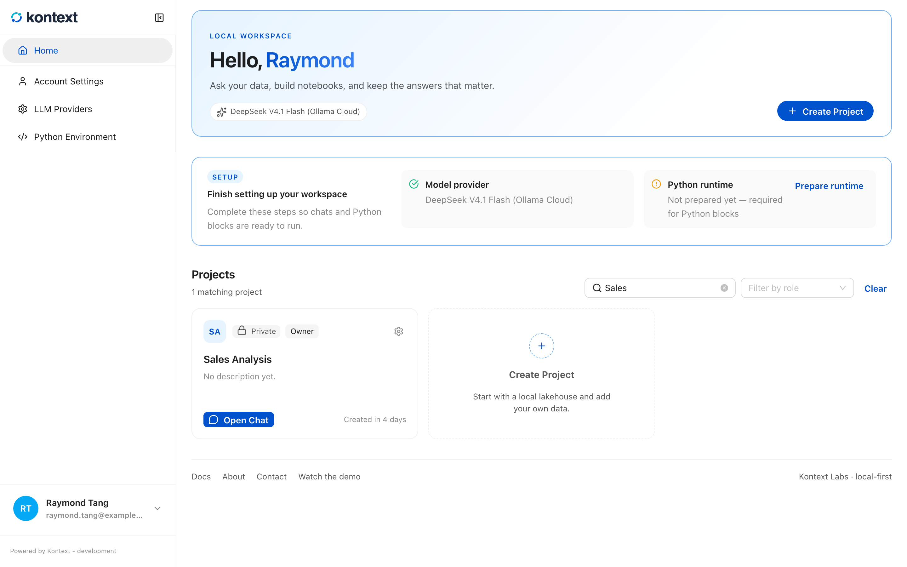
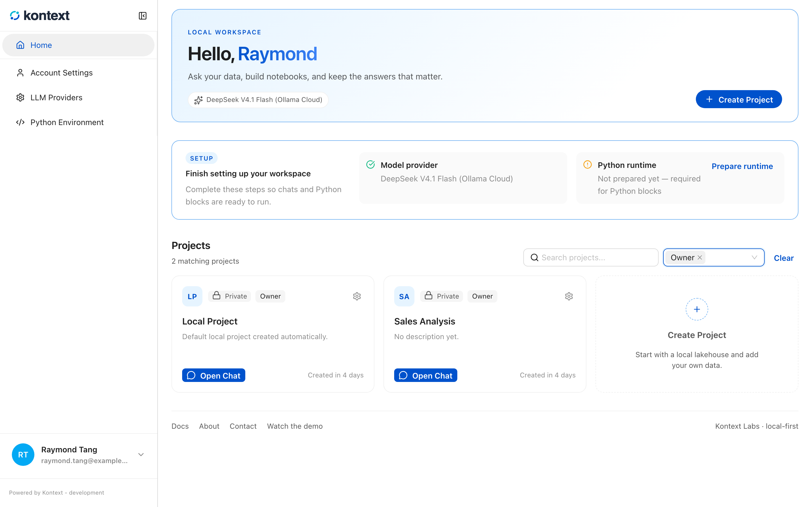
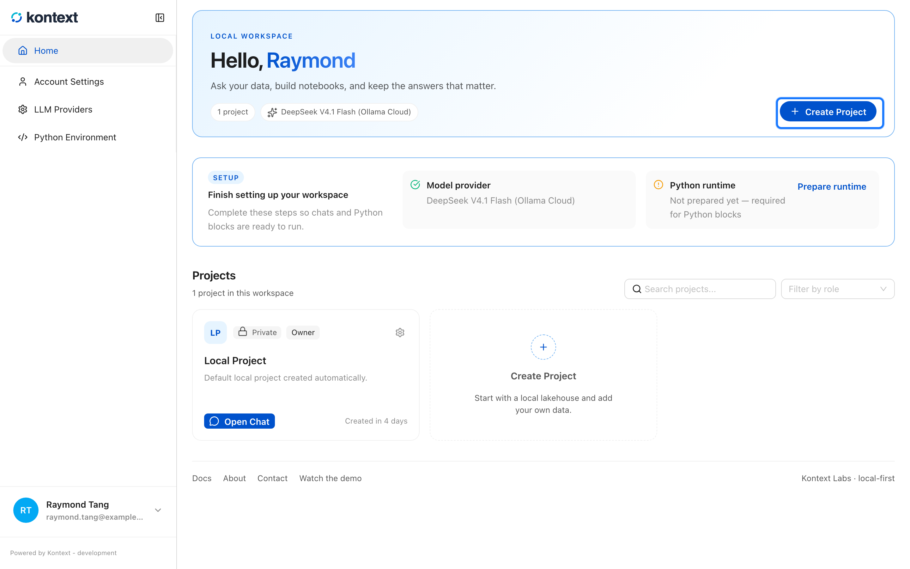
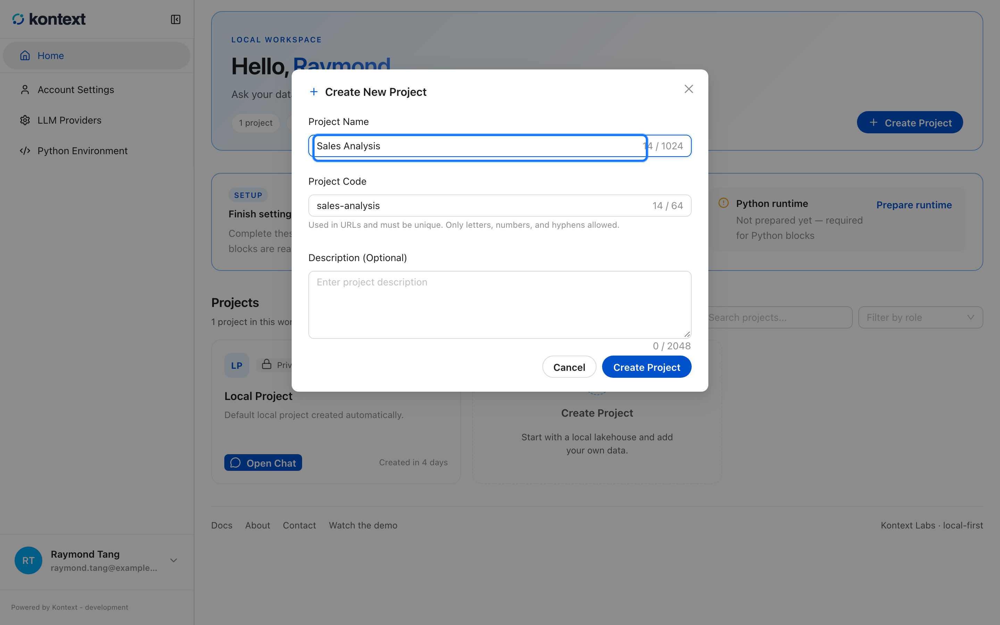
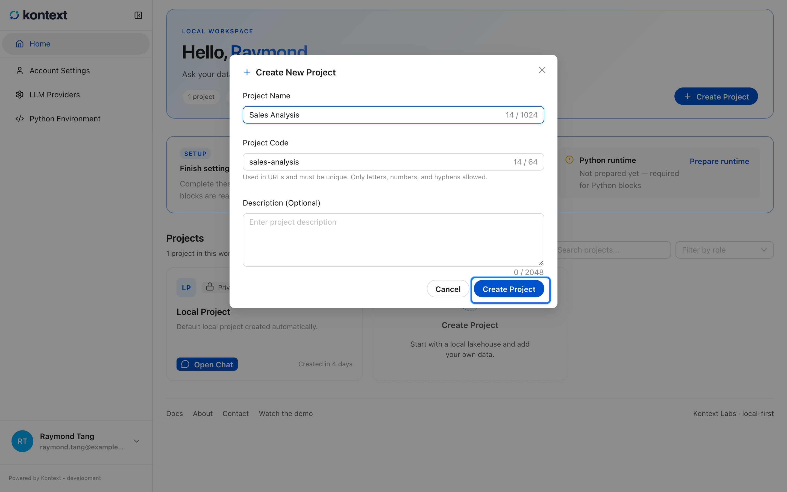
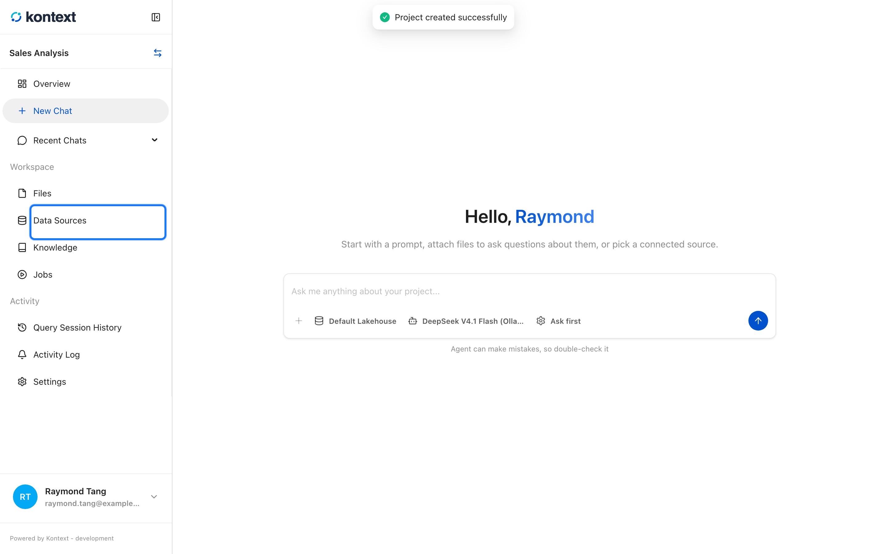

# Open or create a project

Everything in Kontext lives inside a project. A project owns its data sources,
files, notebooks, chats, and settings, and every screen in the app is scoped to
one project at a time.

## Open a project

The home page lists the projects you can access. Select a project name to open
its overview, which gathers the data sources, files, notebooks, chats, and
settings for that project. See
[Project overview and usage](15-project-overview.md) for the stats and project
details tabs.

## Find a project

The search box matches project names, and **Filter by role** narrows the list to
the projects where you have a chosen role. **Clear** removes both filters.

<!-- docs:capture 02-create-a-project#2 hash=51519e286b72 -->
1. The search box filters the project list by name. **Clear** removes the search and role filters.
   
2. **Filter by role** limits the list to projects where you have a given role, such as owner, admin, contributor, or reader.
   
<!-- /docs:capture -->

## Create another project

<!-- docs:capture 02-create-a-project hash=be53151575ac -->
1. Select **Create Project** on the home page.
   
2. Give the project a name. Kontext derives the project code from it, and the code appears in the project URL.
   
3. Select **Create Project** in the dialog to open the new project.
   
4. The project overview collects data sources, files, notebooks, chats, and settings.
   
<!-- /docs:capture -->
