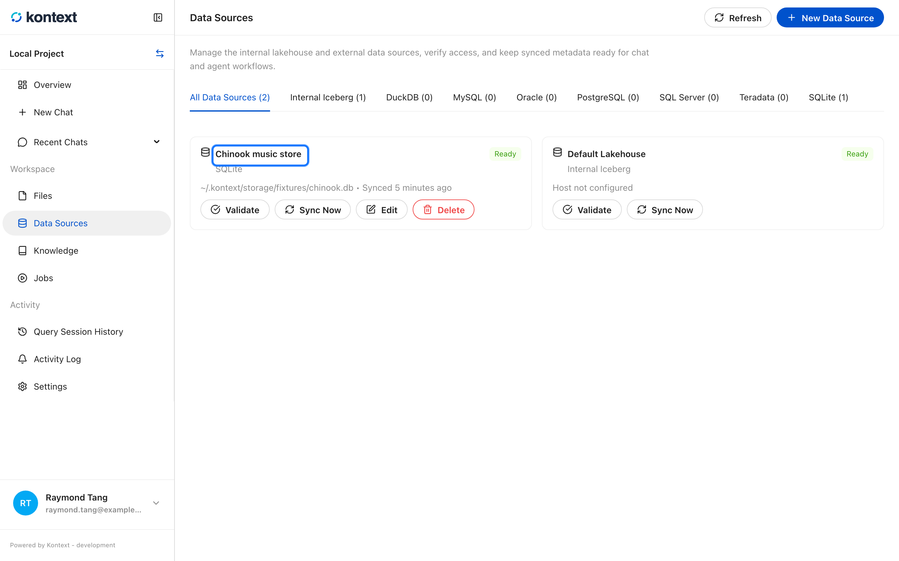
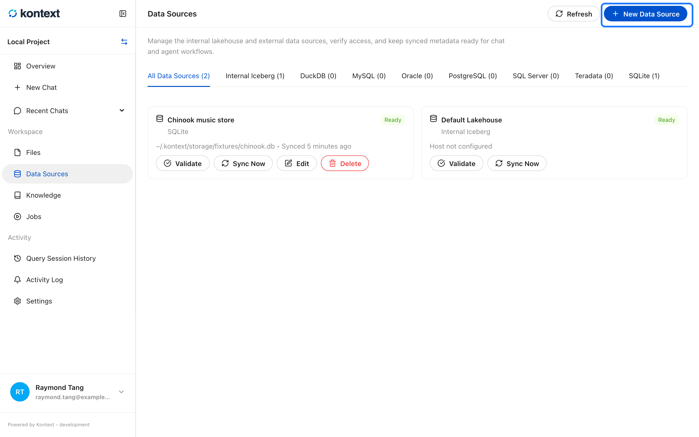
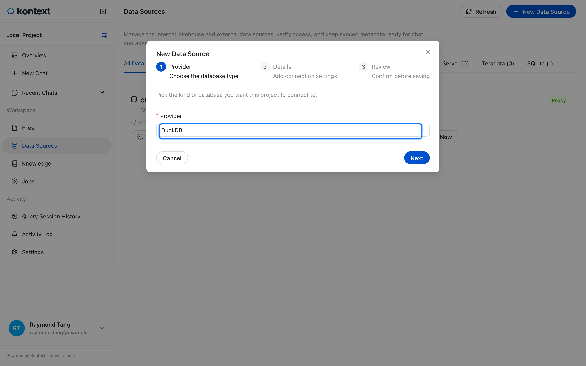
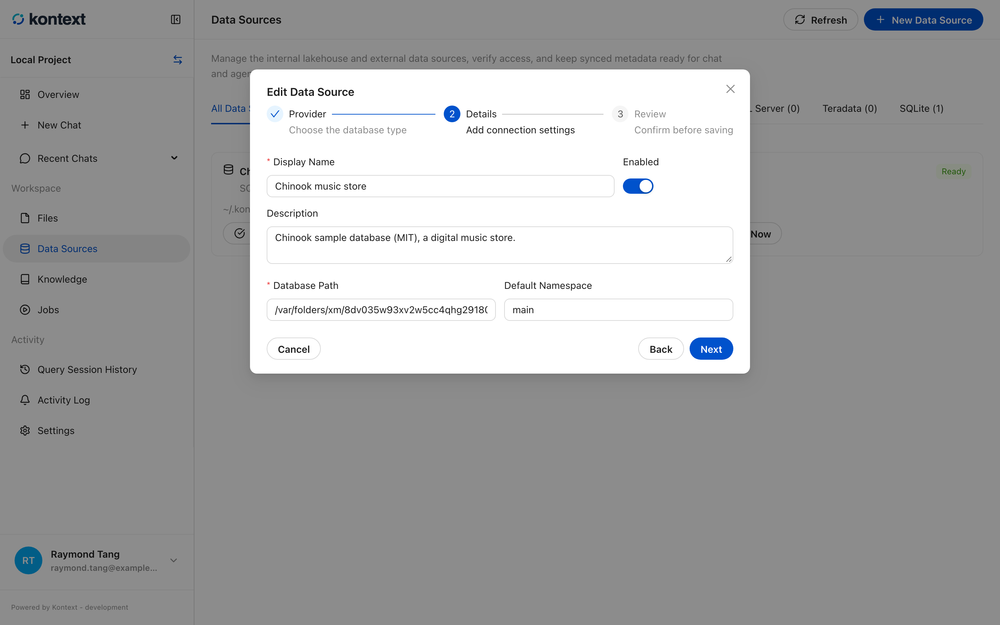
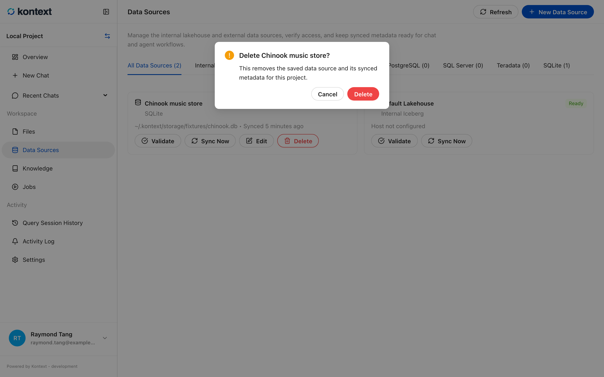

# Connect a data source

A project reads data through data sources. Every project has one default
lakehouse, and you can add external databases beside it.

## The default lakehouse

**Default Lakehouse** is an Iceberg catalog that Kontext Studio manages for the
project. It needs no credentials, it is always present, and it is where imported
files and generated artifacts are registered. Agents and the query editor can
read it without extra setup, which is why a new project can answer questions
before you connect anything else.

## Supported sources

| Source | Type | Notes |
| --- | --- | --- |
| Default Lakehouse | Lakehouse | Managed Iceberg catalog; always present |
| DuckDB | SQL, file-based | Point it at a `.duckdb` file |
| SQLite | SQL, file-based | Point it at a `.db` file |
| PostgreSQL | SQL, server | Host, port, database, credentials |
| MySQL | SQL, server | Host, port, database, credentials |
| SQL Server | SQL, server | Definition only in this runtime; queries are not executed yet |
| Oracle | SQL, server | Definition only in this runtime; queries are not executed yet |
| Teradata | SQL, server | Definition only in this runtime; queries are not executed yet |
| Snowflake | SQL, cloud | Definition only in this runtime; queries are not executed yet |
| BigQuery | SQL, cloud | Definition only in this runtime; queries are not executed yet |
| HTTP API | API | Definition only in this runtime; queries are not executed yet |

Default Lakehouse (Iceberg), DuckDB, SQLite, PostgreSQL, and MySQL are fully
usable in local mode. SQL Server, Oracle, Teradata, Snowflake, BigQuery, and HTTP API can be
registered so the project records how they are reached, but this runtime does
not yet run queries against them.

## What the page shows

**Data Sources** lists every connection with its provider, readiness, and
connection details. External sources can be validated, synced, edited, or
removed. Syncing reads the source's schema so the query editor and agents know
which tables and columns exist.

## Add an external source

<!-- docs:capture 03-connect-a-data-source hash=53d22ff66f7d -->
1. Each connected source shows its provider, readiness, and connection details. **Sync Now** refreshes its schema.
   
2. Select **New Data Source** to add another connection.
   
3. Choose a provider. External databases and file-based sources share the same wizard: provider, details, and review.
   
4. **Edit** reopens the connection form with its saved values. Leave a stored secret blank to keep it.
   
5. **Delete** removes the saved connection and its synced metadata after a confirmation, without touching the database itself.
   
<!-- /docs:capture -->
