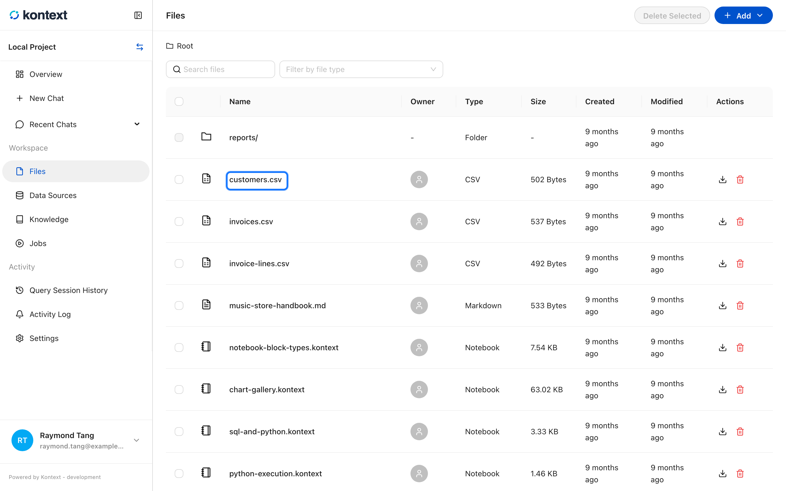
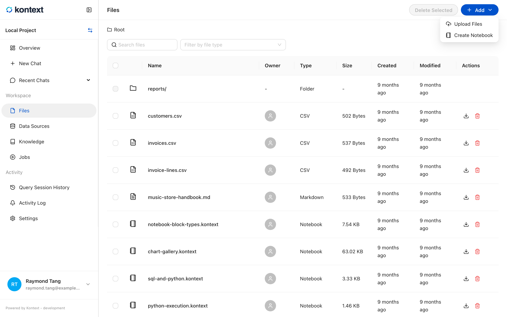
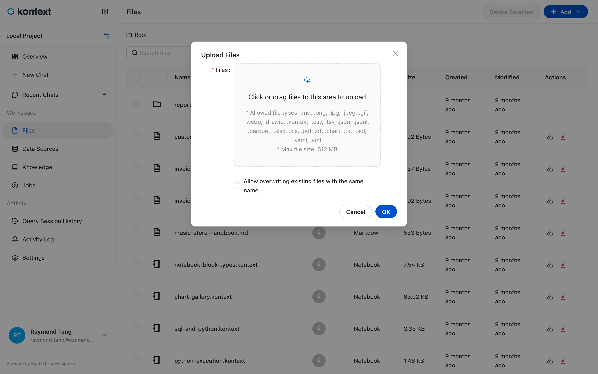
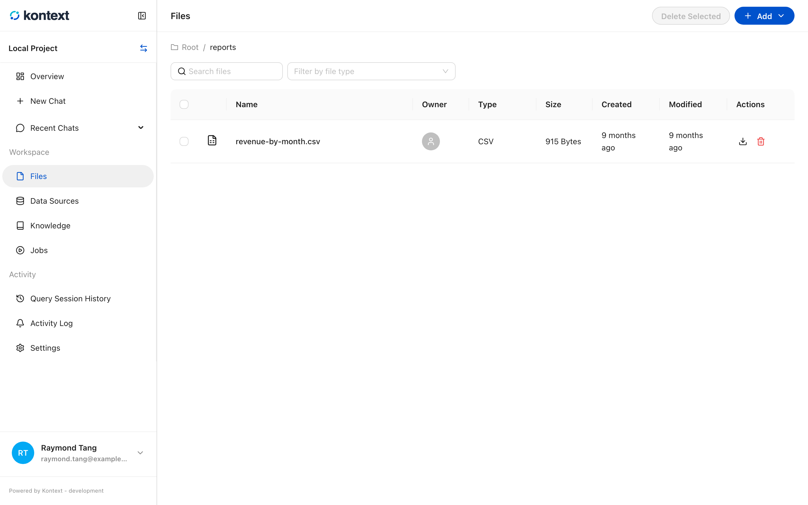
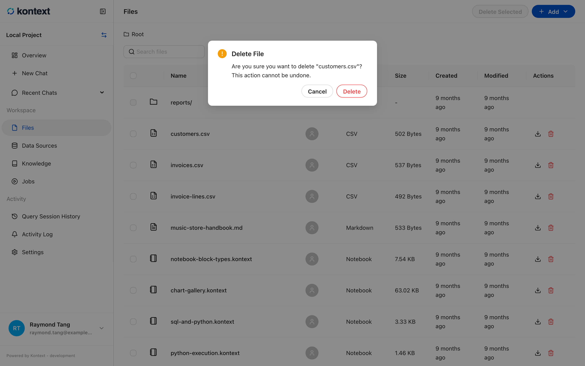
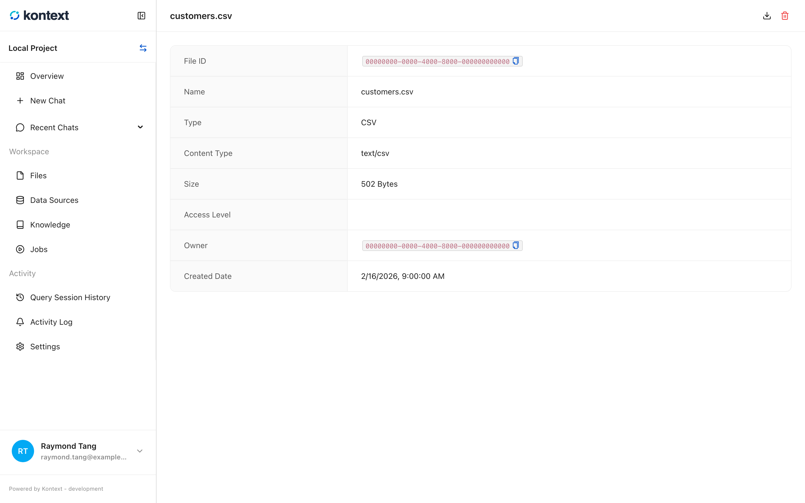

# Browse and manage files

**Files** is the project's storage. It holds uploads, notes, notebooks, and saved
query results, and every entry is a real file in the project directory on your
machine.

## Browse, upload, and manage files

**Add** uploads files or creates a notebook in the current folder. Search and the
file-type filter narrow a large project, folders keep related files together, and
the actions on each row download or delete it.

<!-- docs:capture 04-browse-and-open-files hash=5e1b080db7af -->
1. **Files** lists everything stored in the project. Select a name to open it.
   
2. **Add** starts an upload or creates a notebook in the current folder.
   
3. **Upload Files** accepts a drag-and-drop or a file picker, shows the allowed types and size limit, and can overwrite a file with the same name.
   
4. Search filters by name, and the file-type filter narrows the list to notebooks, charts, data tables, or uploads.
   
5. Folders group related files. The breadcrumb shows the current folder, and selecting **Root** returns to the project root.
   
6. Select the trash icon on a file to delete it. Kontext asks for confirmation because deleting a file removes it from the project.
   
7. A file opens on its details page, which records its type, size, owner, and creation date.
   
<!-- /docs:capture -->
