# Work with notebooks

A notebook is an ordered list of typed blocks saved as a single JSON document.
It can mix prose, tables, SQL, Python, charts, diagrams, and images, and the
results you see are stored with the document rather than recomputed on open.

## Block types

| Block | Use it for |
| --- | --- |
| Heading | Section titles, levels 2 to 5 |
| Paragraph | Rich text with bold, links, and inline code |
| List | Ordered, unordered, and checklist lists, including nested items |
| Quote | A highlighted statement with an optional attribution |
| Delimiter | A visual break between sections |
| Table | A small static table with an optional header row |
| SQL | A query, its result, and a notebook-scoped alias |
| Python | Executable code with saved text, image, or JSON output |
| Chart | A visualization with its configuration and data |
| Mermaid | A diagram written as text |
| Image | An embedded file with a caption and border option |
| Image picker | A reference to an image in the project resource library |

## Insert and arrange blocks

Hover a block to reveal its toolbar. **+** inserts a new block after it, and the
settings button moves, duplicates, or deletes the block. **Preview** renders the
notebook with the editing controls hidden, which is useful before sharing it.

<!-- docs:capture 05-work-with-notebooks#5 hash=3d8f8c3d5f7c -->
1. Hover a block and select **+** to insert another block. The menu lists text, table, SQL, Python, chart, diagram, and image blocks.
   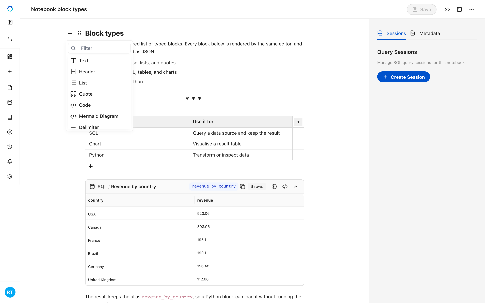
2. The block settings menu changes the block type and heading level, and moves it within the notebook.
   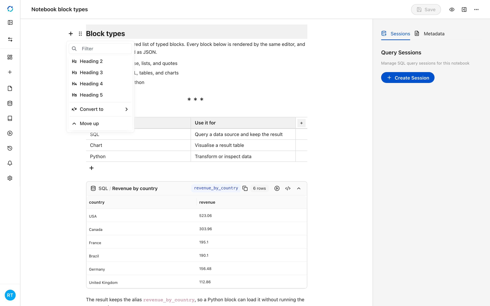
3. **Preview** hides the editing controls and renders the notebook as a reader would see it. Select the pencil to return to editing.
   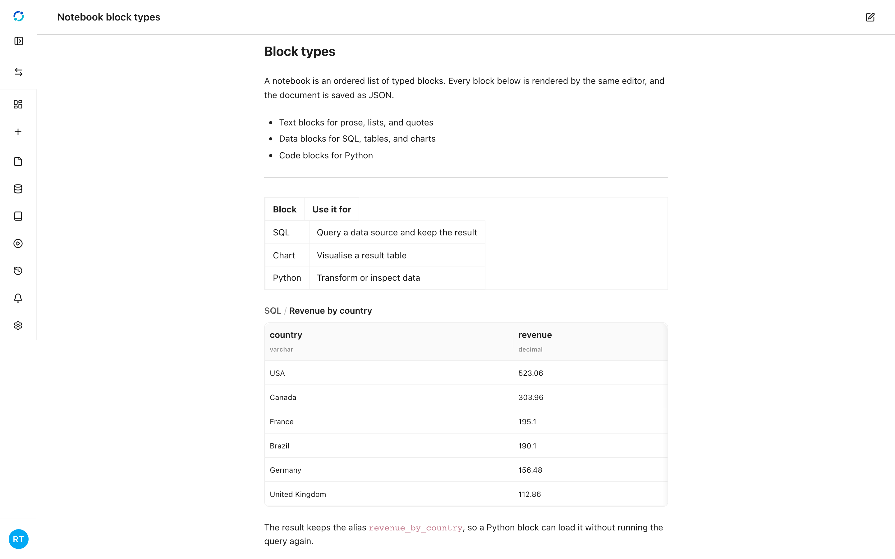
<!-- /docs:capture -->

## Text and structure

Headings, paragraphs, lists, quotes, delimiters, and tables need no data
connection, and they are the fastest way to make a notebook readable.

## Data and code

A **SQL** block keeps the query text, the result table, and an optional alias.
The alias makes the result available to Python blocks without running the query
again. A **Python** block runs in the project runtime and stores its outputs. A
**chart** block holds its configuration and the data it visualizes.

<!-- docs:capture 05-work-with-notebooks hash=c3ce347cacb1 -->
1. A notebook is an ordered list of typed blocks. Text blocks cover headings, paragraphs, lists, and quotes.
   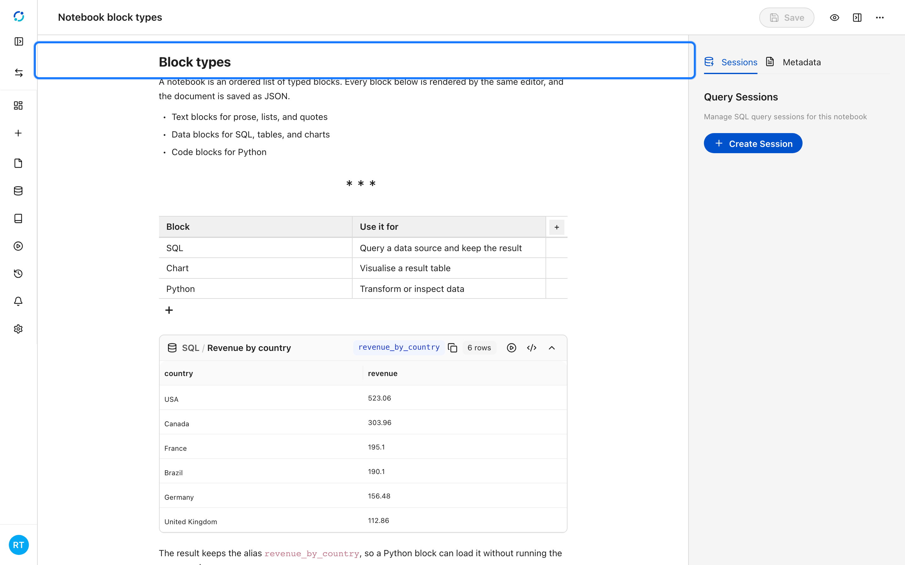
2. Table blocks hold static rows with an optional header row. They are useful for short reference tables that do not need a query.
   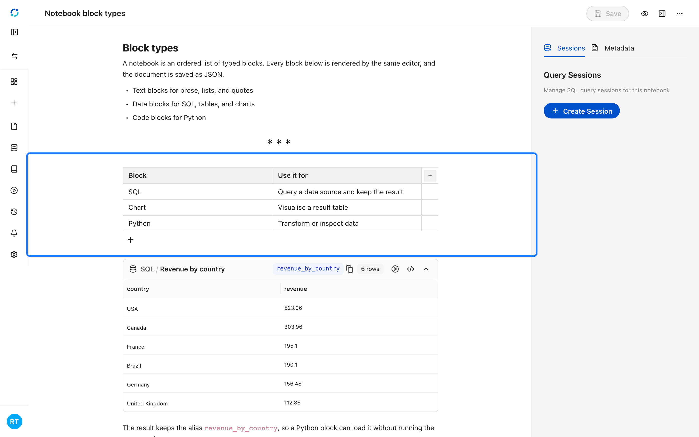
3. A SQL block keeps its query, its result, and a notebook-scoped alias in the document.
   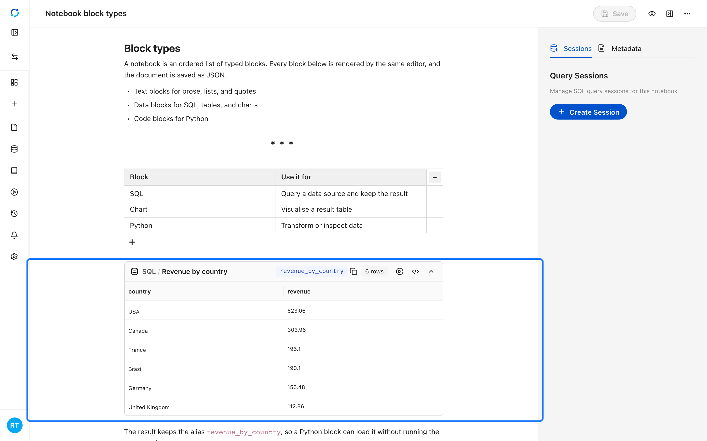
4. A Python block runs code and keeps its output. The SQL alias from the previous block is available without re-running the query.
   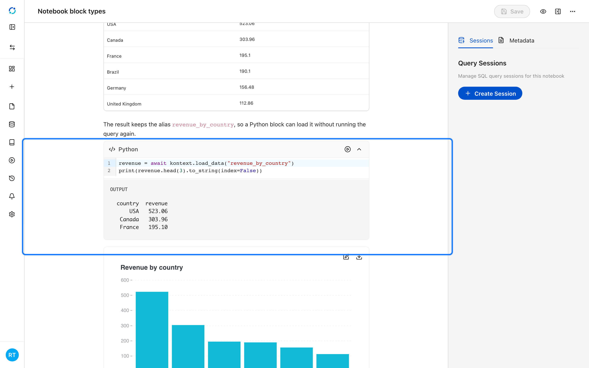
5. Mermaid blocks render diagrams from text, so architecture notes stay editable.
   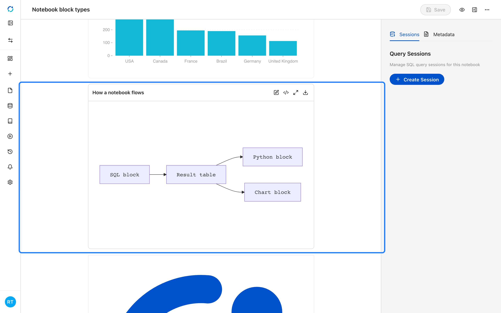
6. Image blocks embed a file with an optional caption and border.
   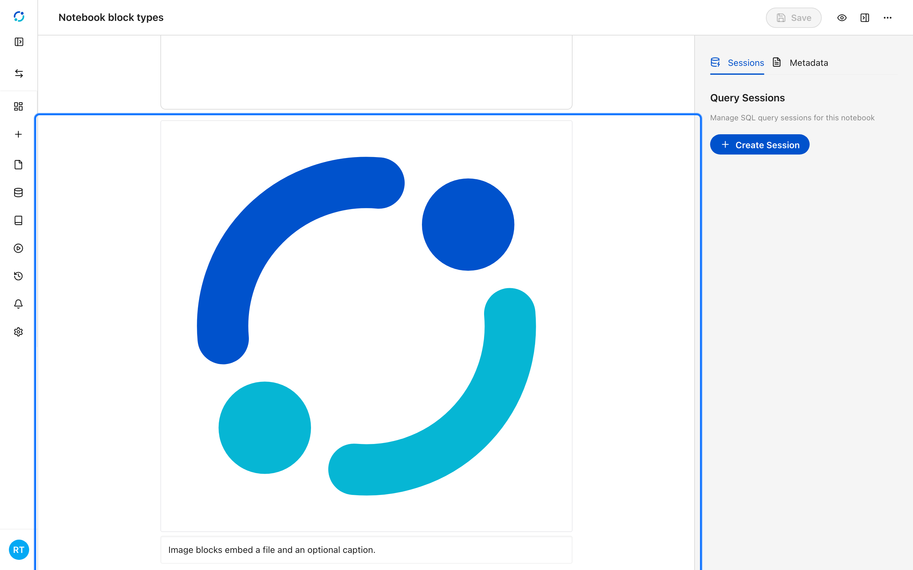
<!-- /docs:capture -->

## The full SQL editor

Select the code icon on a SQL block to open the full editor. It shows the query,
an **Execute** action, and an **Output** tab with the result grid and column
types. The editor is the place to iterate on a query before saving the block.

<!-- docs:capture 05-work-with-notebooks#2 hash=8a030425f7e2 -->
1. Select the code icon on a SQL block to open the full editor. It shows the query, the catalog scope, and the run controls.
   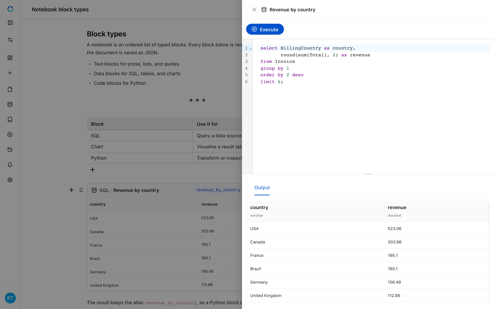
<!-- /docs:capture -->

<!-- docs:capture 05-work-with-notebooks#4 hash=618c48b561e9 -->
1. A SQL block keeps its query and result inline. Open it in the full editor to read the query and its stored output side by side.
   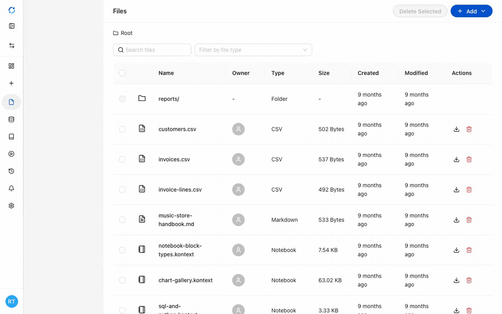
<!-- /docs:capture -->

## Saved data tables

A result can also be stored as a standalone `.dt` data table in the project
files. Opening one shows a read-only grid with the column types and row count.

<!-- docs:capture 05-work-with-notebooks#3 hash=6026d5c97295 -->
1. A saved **.dt** data table opens in a read-only grid with its column types and row count.
   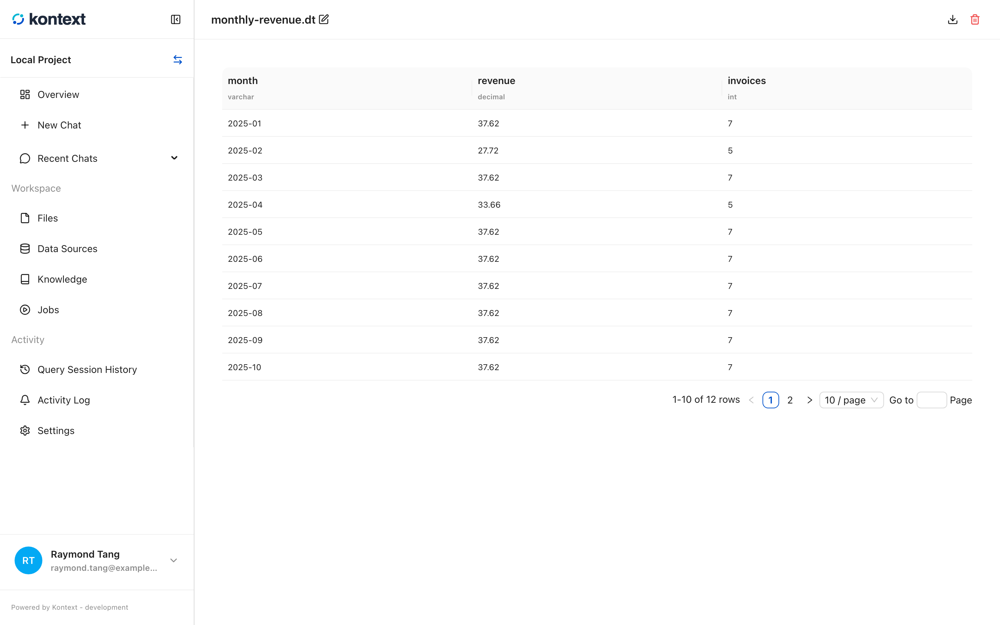
<!-- /docs:capture -->
