# Chart results

Charts are notebook blocks or standalone `.chart` files. Both keep their
configuration and data together, so a chart reopens exactly as you left it.

## Chart types

| Chart | Use it for |
| --- | --- |
| Line | Trends over time |
| Bar | Comparing categories with long labels |
| Column | Comparing categories vertically |
| Area | Volume or a running total |
| Pie | Composition across a few slices |
| Scatter | The relationship between two numeric measures |
| Dual axes | Two measures with different scales |
| Funnel | Stages or segments ranked by size |
| Heatmap | Intensity across two categories |
| Histogram | The distribution of one numeric field |
| Box | Median, quartiles, and outliers per category |
| Radar | Profiles across several dimensions |
| Stock | Open, close, low, and high per period |

## Adjust a chart

Select **Edit** on a `.chart` file, or the pencil on a notebook chart block. The
editor exposes the chart type, the color palette, the number format, and the
field mapping: category and value, aggregation, series grouping, stacking, and
grouping of side-by-side series. The preview updates as you change a setting, and
**Save to File** persists the choice.

Charts read either embedded data or a saved data table, and a chart built from a
notebook query points at that result table.

<!-- docs:capture 06-chart-results#2 hash=607bf0d73b04 -->
1. Open a **.chart** file and select **Edit** to change its type, fields, palette, and number format.
   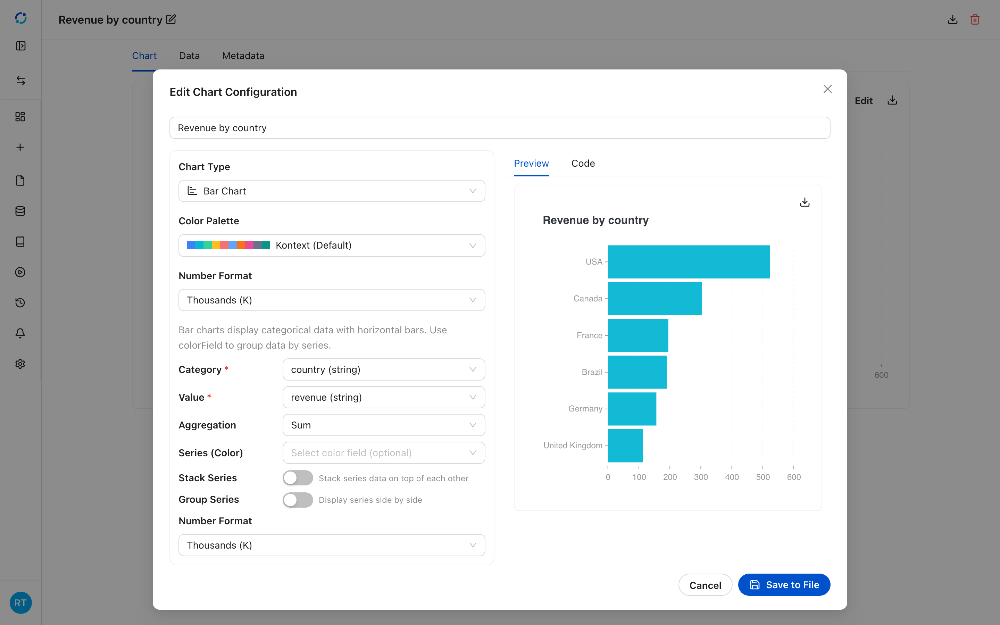
<!-- /docs:capture -->

## Every chart type

The gallery below uses the Chinook store data. Each block keeps its own data
table, so the chart is readable without running the notebook.

<!-- docs:capture 06-chart-results hash=e9d3f765cc3a -->
1. Open the chart gallery notebook from the project files.
   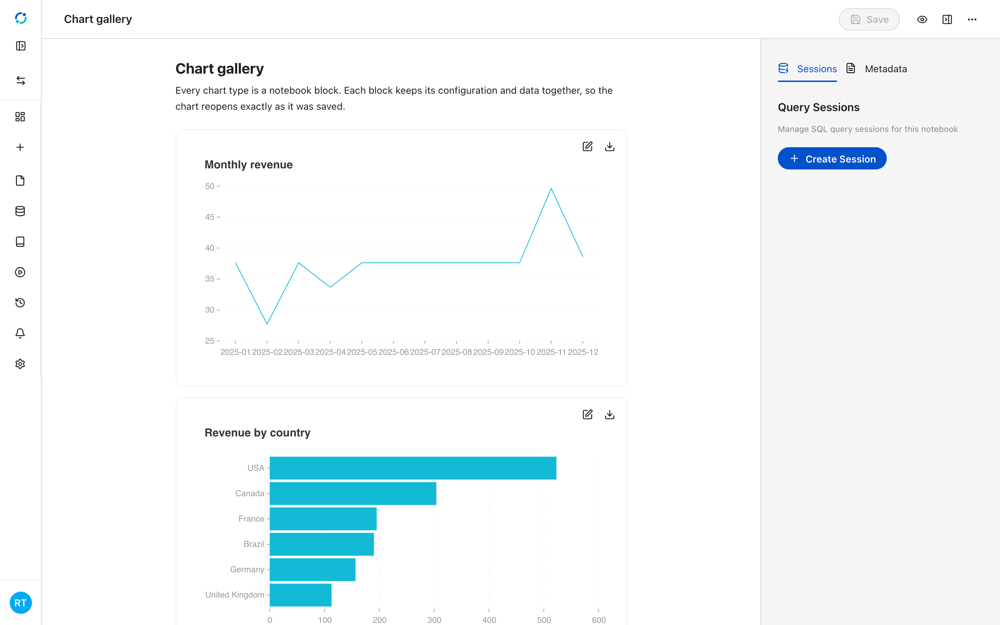
2. A **line** chart shows a measure over time; use it for trends.
   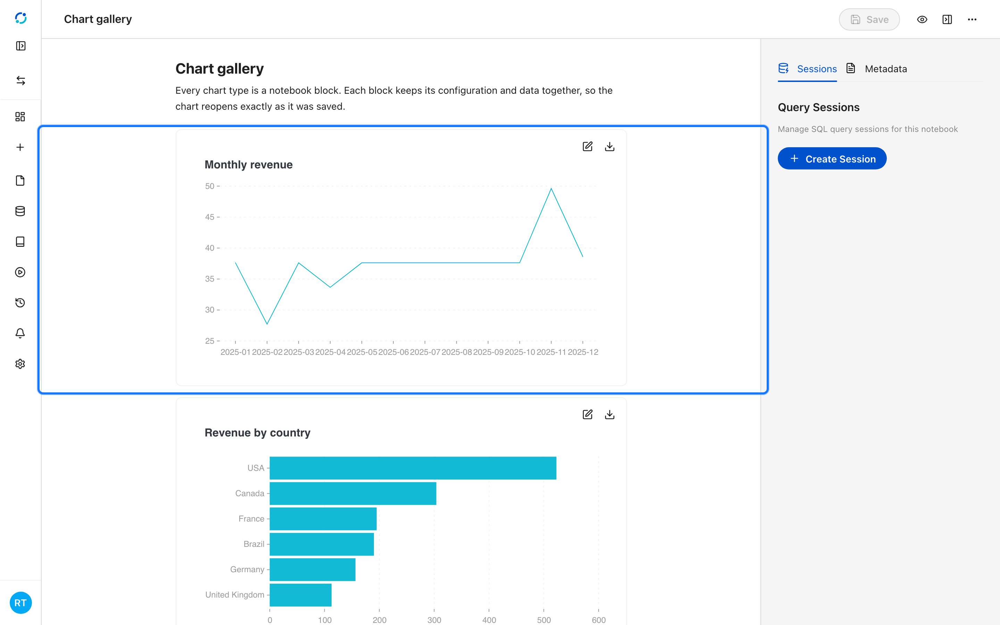
3. A **bar** chart compares categories with horizontal bars, which stay readable with long labels.
   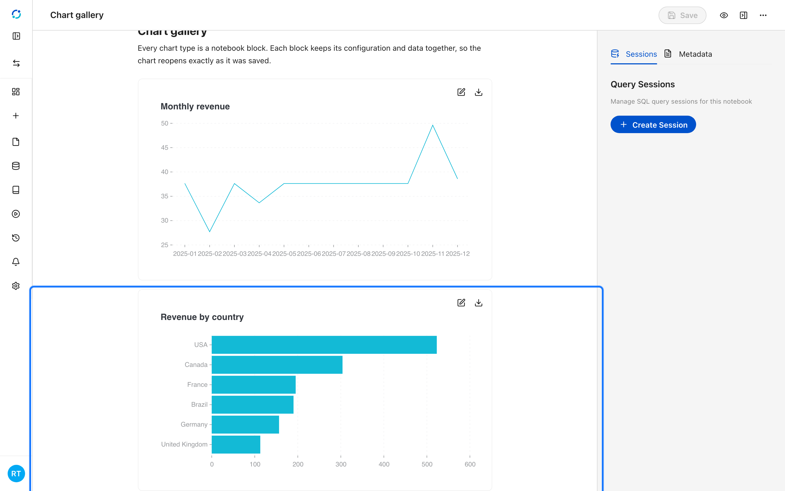
4. A **column** chart compares categories vertically.
   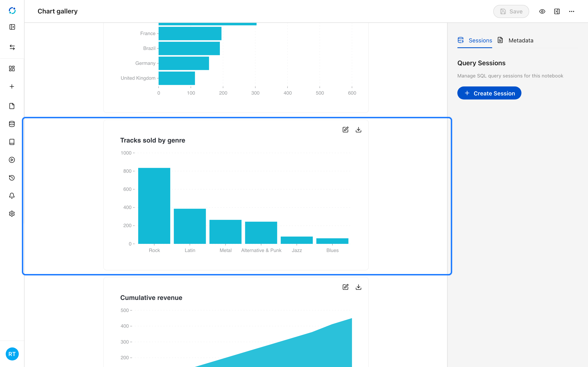
5. An **area** chart emphasizes volume or a running total.
   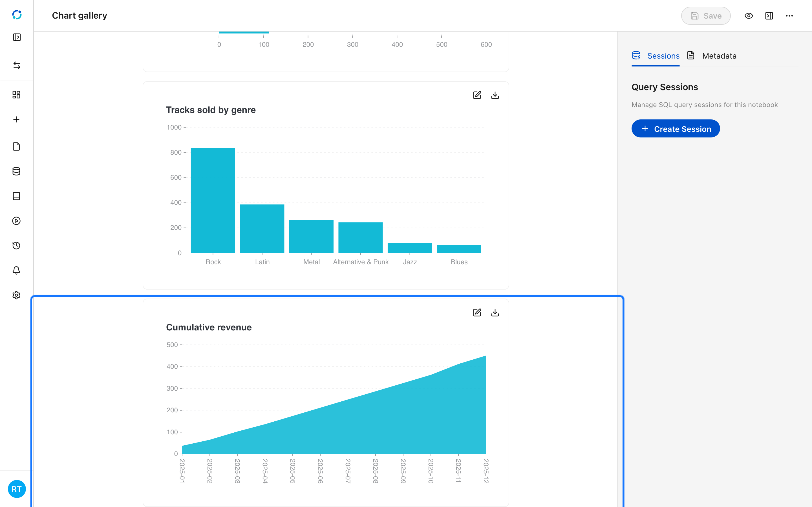
6. A **pie** chart shows composition; keep it to a handful of slices.
   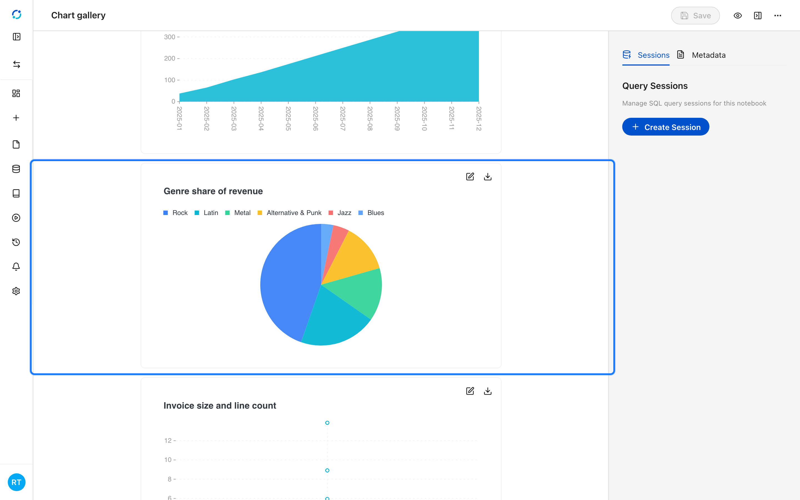
7. A **scatter** chart shows the relationship between two numeric measures.
   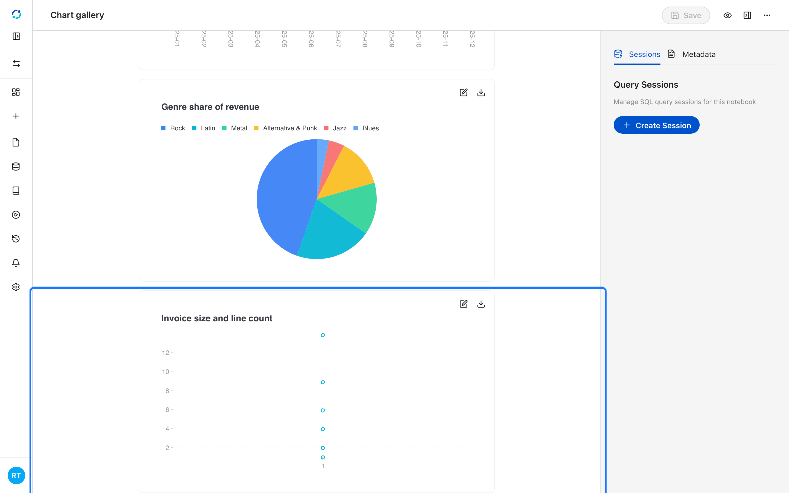
8. A **dual-axes** chart plots two measures with different scales.
   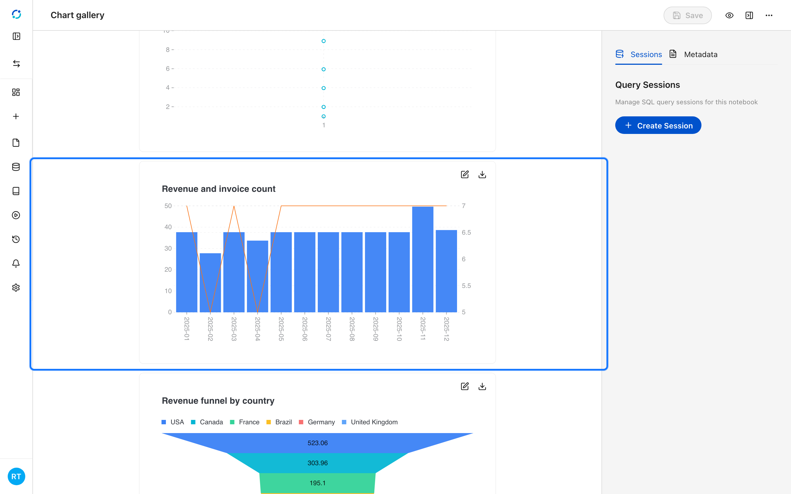
9. A **funnel** chart ranks stages or segments by size.
   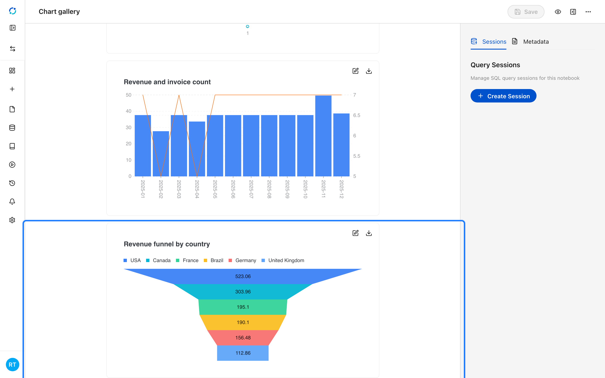
10. A **heatmap** shows intensity across two categories.
   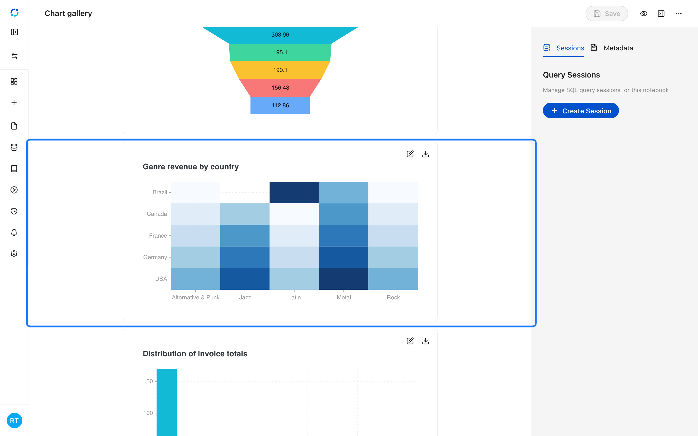
11. A **histogram** shows the distribution of one numeric field.
   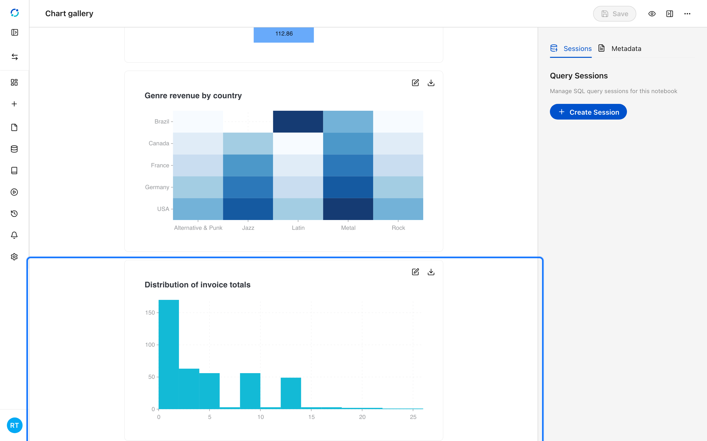
12. A **radar** chart compares profiles across several dimensions.
   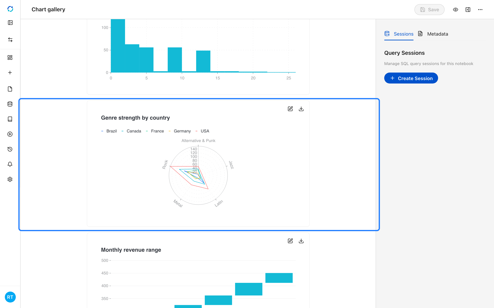
13. A **stock** chart shows open, close, low, and high for each period.
   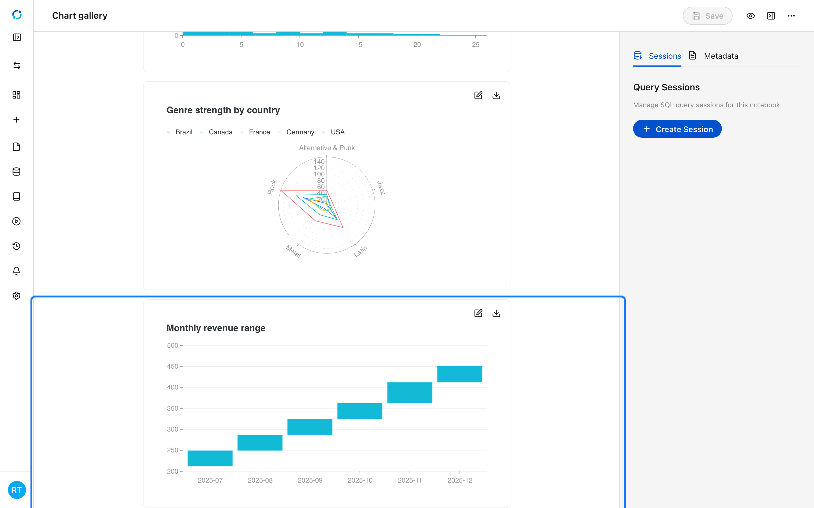
<!-- /docs:capture -->
