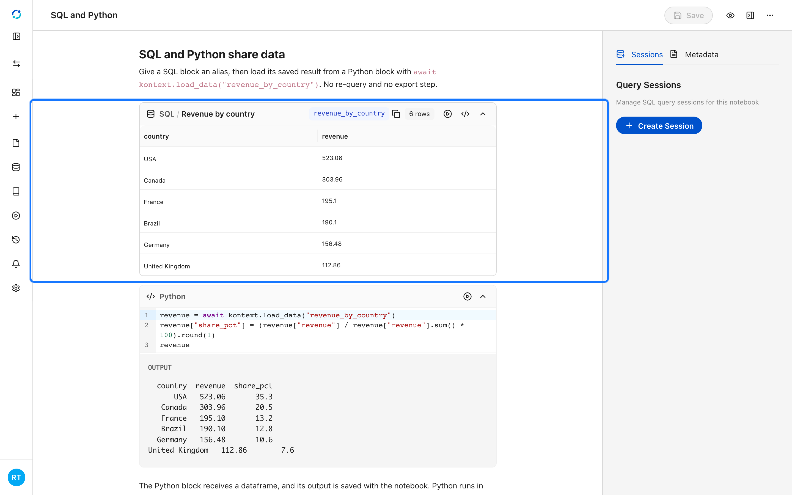
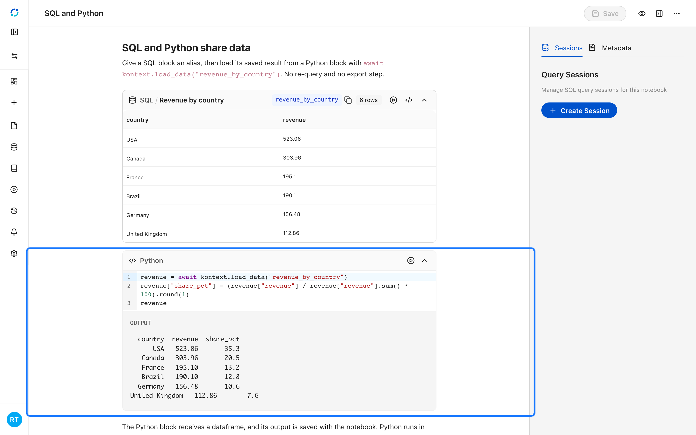
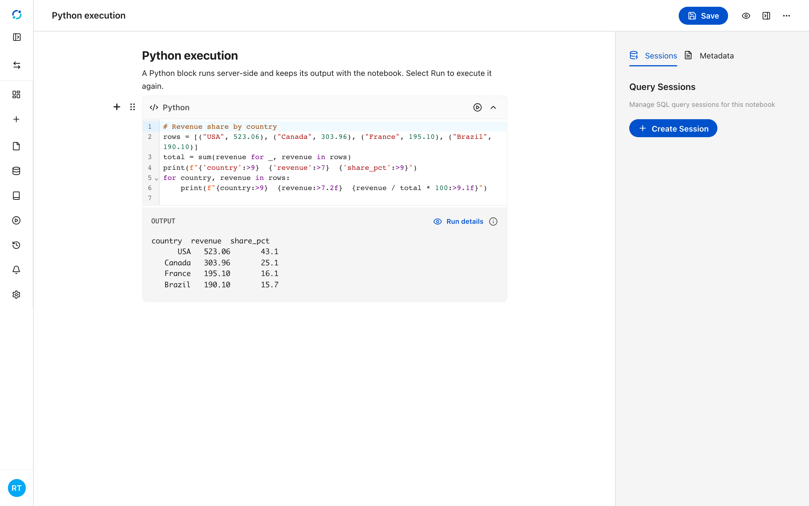
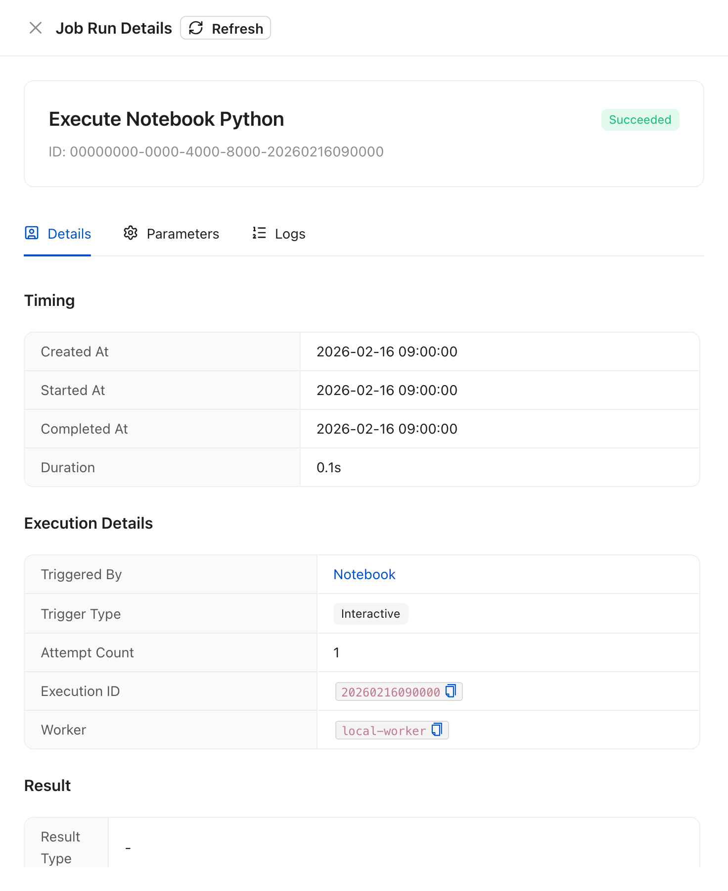

# Python and data frames

Python blocks run in the project runtime, not in the browser. They receive a
dataframe API, and their output is stored in the document, so a reopened
notebook shows the same text, JSON, and images without running anything again.

Before the first run, check [Python environment](12-python-environment.md). If it
reports **Needs preparation**, select **Prepare Environment** so the managed
runtime exists.

## Share a SQL result with Python

Give a SQL block an alias, then load it from Python:

```python
revenue = await kontext.load_data("revenue_by_country")
revenue["share_pct"] = revenue["revenue"] / revenue["revenue"].sum() * 100
revenue
```

The alias is notebook-scoped. The result is already materialized, so loading it
does not re-run the query, and the dataframe is available to later blocks in the
same notebook.

<!-- docs:capture 07-python-and-data-frames hash=43323e068e50 -->
1. The SQL block keeps its result and binds it to the alias **revenue_by_country**.
   
2. The Python block loads the result with `await kontext.load_data("revenue_by_country")`, adds a share column, and returns a dataframe. Python runs server-side in the project runtime.
   
<!-- /docs:capture -->

## Run a block

Select **Run** on the Python block. Kontext executes the code in the project
runtime, stores the output with the notebook, and links the block to the managed
**Run details** for that execution.

<!-- docs:capture 07-python-and-data-frames#2 hash=5e6f79807f63 -->
1. Select **Run** on a Python block to execute it. The output is stored with the notebook and the block links to the managed **Run details**.
   
2. **Run details** reports the execution status, timing, actor, and parameters for the block run.
   
<!-- /docs:capture -->

## Outputs

A Python block can return plain text, a JSON payload such as a dataframe
preview, an image, or a reference to an uploaded file. All of them are saved
with the notebook and survive a reload.

## Save a data frame as a data table

To keep a dataframe beyond the notebook, persist it as a data table:

```python
saved = await kontext.save_table(revenue, "revenue_by_country")
saved["dataTableId"]
```

The table becomes a `.dt` file in the project files, so it can be reopened on
its own or used as the source for a chart. Use it for results you want to keep;
intermediate frames do not need to be saved.
