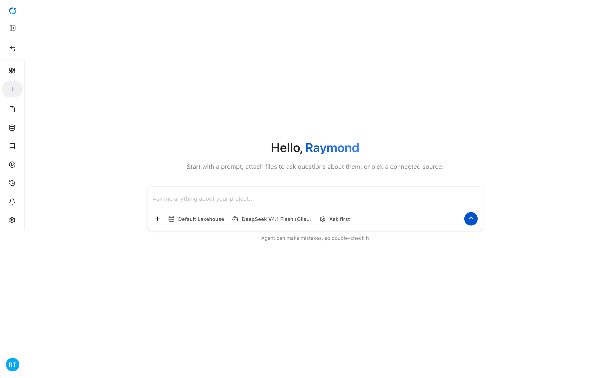
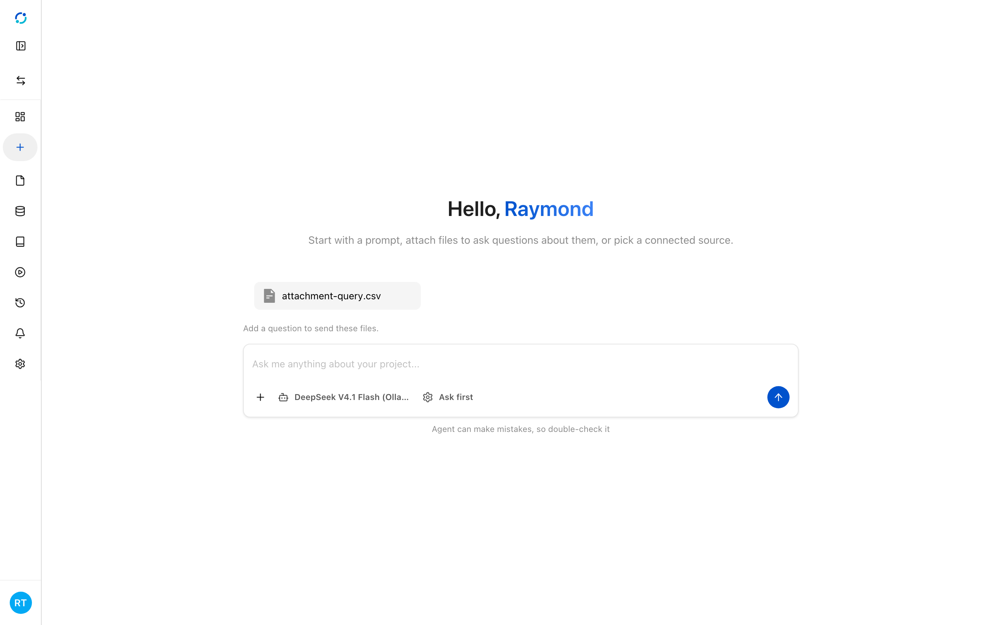
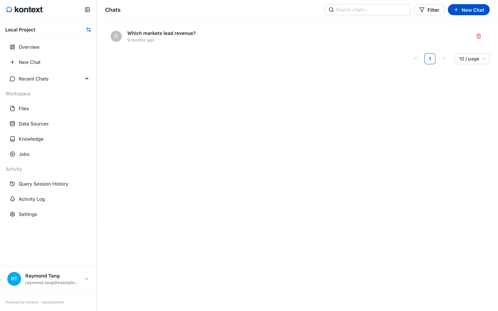
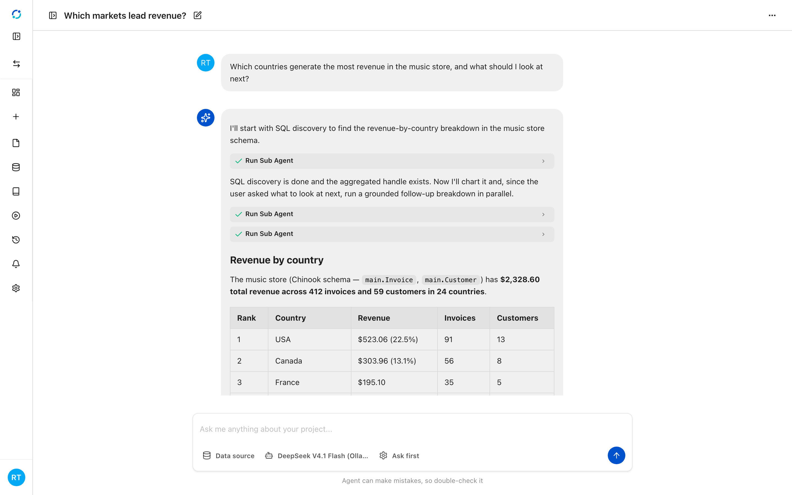
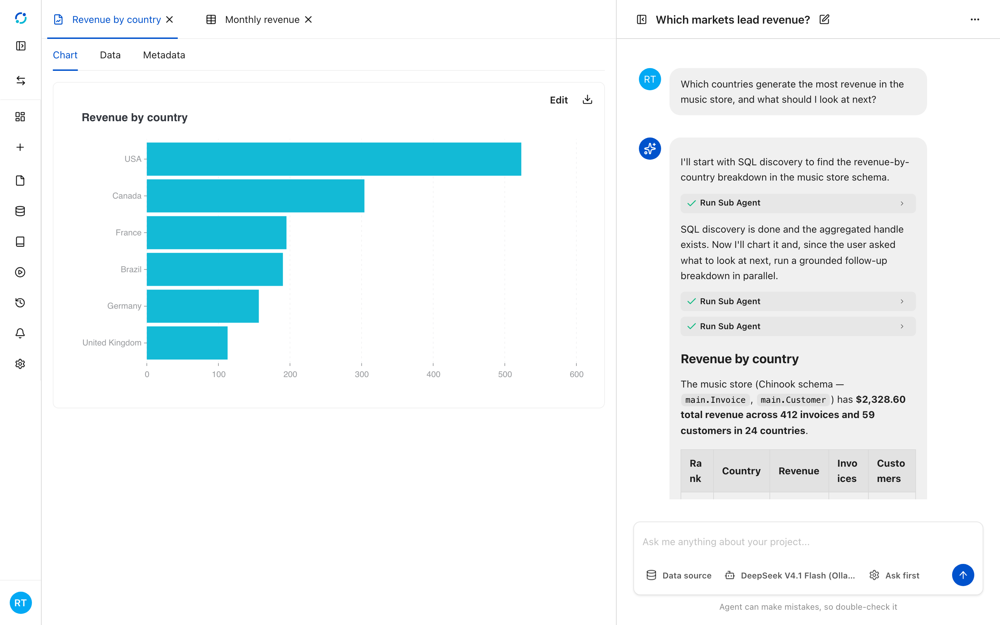

# Chat with an agent

Chat is the fastest way to get something done in a project. You ask a question in
plain language and an agent decides what to do: query a data source, run Python,
build a chart or notebook, or delegate to a specialist agent. The conversation
keeps the answer and the tool calls that produced it, so you can check how a result
was made.

## Start a conversation

Select **New Chat** in the sidebar, or **New Chat** on the Chats page. Before you
send the first message, check the three controls under the composer:

- **Data source** chooses the catalog the agent should query. Without a choice, it
  uses the session's default connection.
- **Model** chooses which model answers. The list comes from the model
  providers you have connected.
- **Ask first** is the Python approval mode. In this mode the agent pauses before
  executing Python so you can approve or reject the code. The other modes run
  Python automatically.

**Attach files** stages a data file for the conversation. The agent can query the
attachment alongside the selected data source, and the question is sent with the
files in one turn.

<!-- docs:capture 08-chat-with-an-agent#3 hash=52e3efd81082 -->
1. **New Chat** opens an empty conversation. The composer chooses the data source, the model, and the Python approval mode before the first message.
   
2. **Attach files** stages a data file for the conversation so the agent can query it alongside the project data.
   
<!-- /docs:capture -->

## Example prompts

The same conversation can explore a project, write SQL, and build output. Some
prompts to start from:

- **Suggest an agenda** — "Suggest three questions based on the data in the project."
- **Inspect the project** — "How many tables are in the data lake?"
- **Write SQL** — "Write a query to show transaction volume by year and month."
- **Run the query** — "Execute the above query with a reasonable limit for previewing results."
- **Ask a data question** — "Which age group has the highest number of customers?"
- **Create a notebook** — "Create a notebook to visualise customer demographics by age band and country."

## Conversations

Every session is saved with a title, an owner, a timestamp, and a message count.
Open **Chats** to search them, filter to your own sessions, or delete one.

<!-- docs:capture 08-chat-with-an-agent hash=70a4e8305faf -->
1. **Chats** lists every conversation in the project. Search by name, filter to your own sessions, or open one to continue it.
   
<!-- /docs:capture -->

## Inside a conversation

A session keeps the question, the answer, and the steps in between. Tool calls
appear inline — for example **Run Sub Agent** when the coordinator delegates SQL,
chart, or notebook work. Expand a call to see what was delegated and what came
back. Answers render Markdown, tables, and links, and the composer stays pinned to
the bottom so you can continue without scrolling back.

<!-- docs:capture 08-chat-with-an-agent#2 hash=4fa253f54162 -->
1. A session keeps the question, the answer, and the tool calls that produced it. Expand **Run Sub Agent** to see what the agent delegated and what came back.
   
2. Artifacts the run created — charts, data tables, notebooks, and images — open beside the conversation, so you can inspect the result without leaving the chat.
   
<!-- /docs:capture -->

## Artifacts

When a run creates a chart, data table, notebook, or image, it becomes an artifact
of the session. The artifact panel opens beside the conversation with a tab per
artifact. A chart artifact shows **Chart**, **Data**, and **Metadata** tabs, and
**Edit** opens the same chart editor used elsewhere. Removing an artifact only
detaches it from the chat; the underlying file stays in the project.
