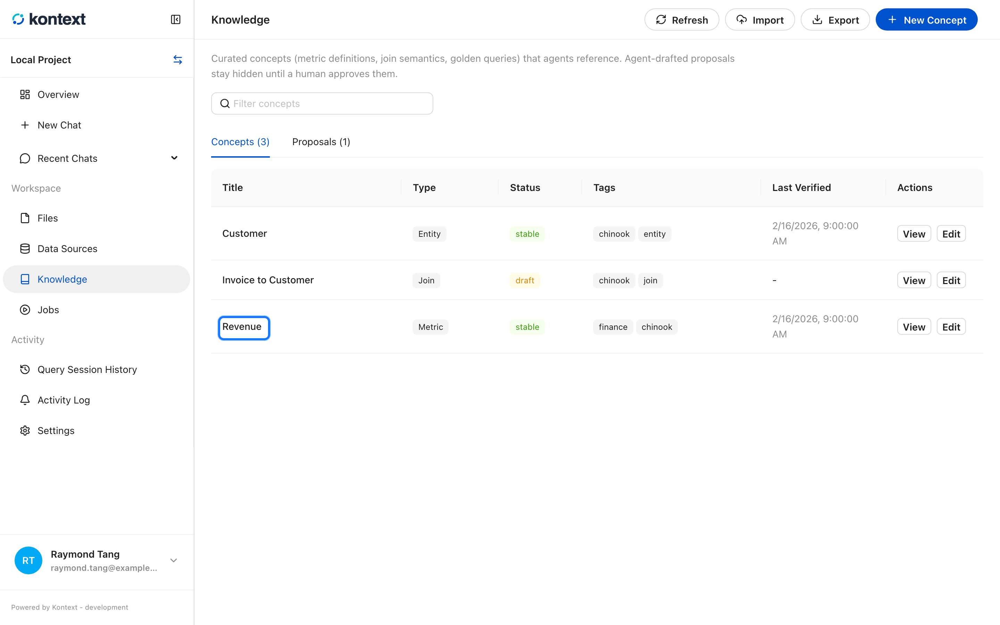
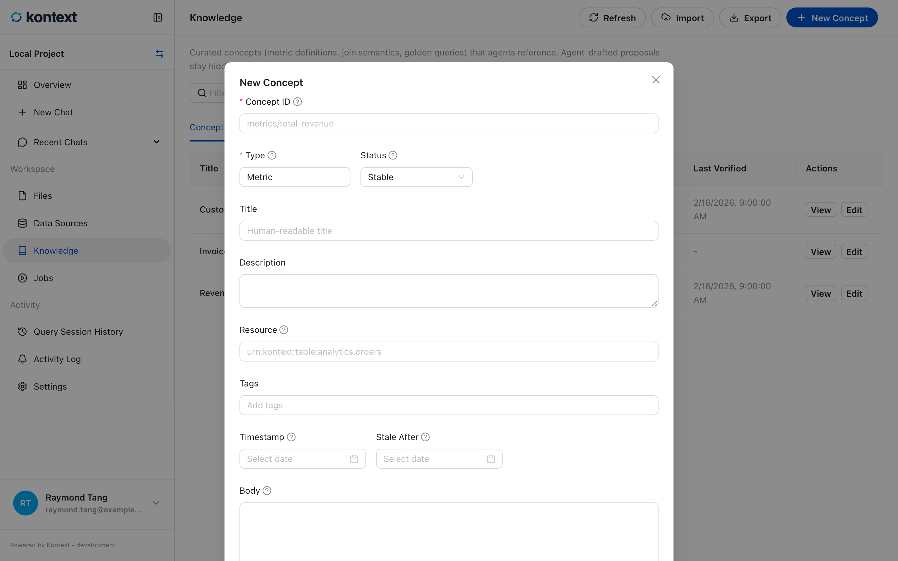
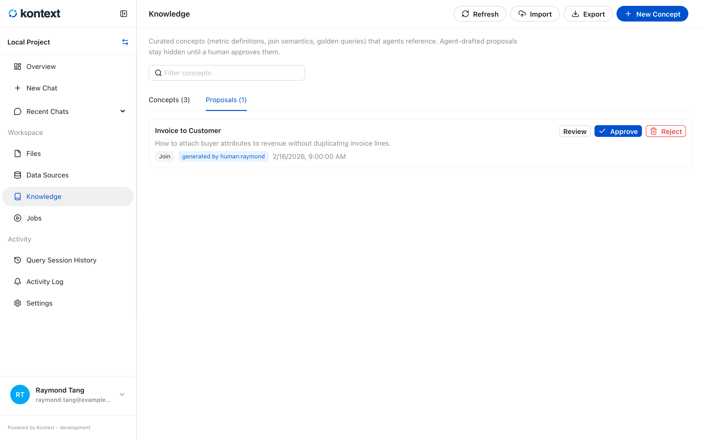
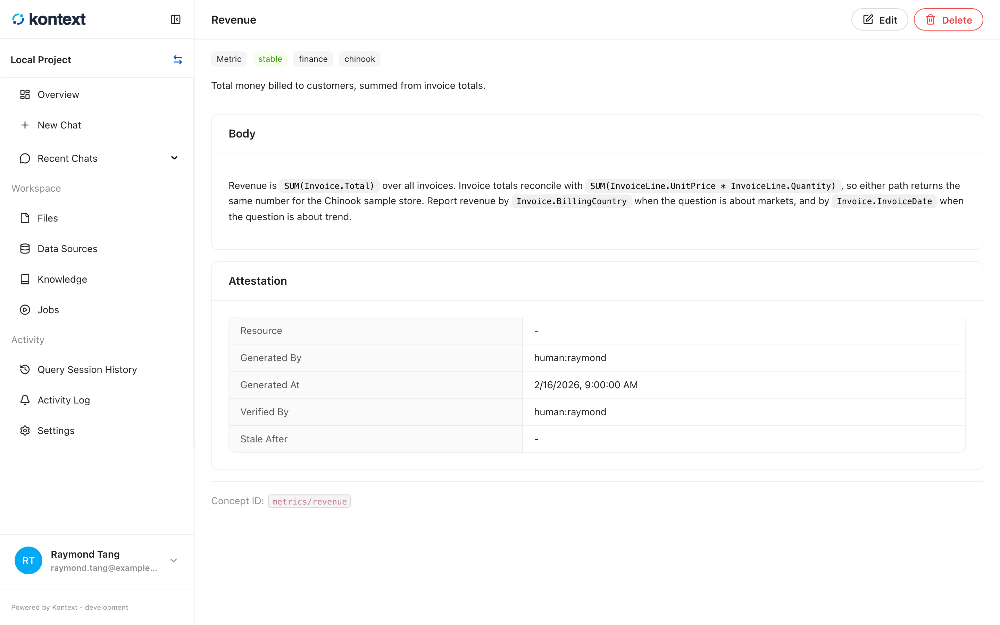

# Ground an agent in knowledge

**Knowledge** is the project's curated business context: metric definitions,
entities, join rules, and golden queries that an agent can cite instead of
guessing. Each entry is a concept in the Open Knowledge Format (OKF), stored in
the project and projected into a search index for retrieval.

Curated concepts are different from the project files. A file is source material;
a concept is a reviewed statement about how the data should be interpreted. That
is why an agent can use it as context for SQL, charts, and explanations.

## Browse concepts

Open **Knowledge** in the project sidebar. The **Concepts** tab lists every
concept with its type, status, tags, and last verification date. The search box
filters by title, id, type, description, and tags.

<!-- docs:capture 09-ground-an-agent-in-knowledge hash=b734c17a101c -->
1. **Knowledge** holds the curated concepts an agent can cite: metric definitions, entities, joins, and golden queries. Each concept carries a type, status, tags, and the last verification date.
   
<!-- /docs:capture -->

## Create or edit a concept

**New Concept** opens the editor. The important fields are:

- **Concept ID** is the stable path, for example `metrics/revenue`. Agents and
  links use it, so keep it readable and don't reuse it for a different meaning.
- **Type** groups the concept: `Metric`, `Entity`, `Join`, `Query`, and so on.
- **Status** controls whether the concept is usable: `draft` is under review,
  `stable` is ready, and `deprecated` is kept for history.
- **Body** is Markdown. Put the actual definition or rule here, including the
  tables and columns it applies to.
- **Stale After** marks when the concept should be reviewed again. A concept past
  that date shows as **stale** even if its status is still `stable`.

Every save updates the durable concept store and the knowledge index together, so
an agent sees the change on its next run.

<!-- docs:capture 09-ground-an-agent-in-knowledge#2 hash=a3ae21d44d31 -->
1. **New Concept** opens the editor: id, type, status, title, description, resource, tags, body, and the freshness window. The id is the stable path agents and links use.
   
<!-- /docs:capture -->

## Review agent proposals

Agents can draft concepts. A draft waits in the **Proposals** tab until a person
approves it. **Review** opens the concept, **Approve** activates it, and
**Reject** deletes it. The proposal keeps the generating actor and timestamp so
you can see where it came from.

<!-- docs:capture 09-ground-an-agent-in-knowledge#3 hash=f39780f7be29 -->
1. The **Proposals** tab is the review queue for agent-drafted concepts. **Review** opens the concept, **Approve** publishes it, and **Reject** removes it.
   
<!-- /docs:capture -->

## Read a concept

A concept page renders the Markdown body and the attestation: the resource it
describes, who generated it, who verified it, and when it was last checked. The
**concept id** is shown at the bottom for use in links and agent context.

<!-- docs:capture 09-ground-an-agent-in-knowledge#4 hash=1fc2dc77446f -->
1. A concept page renders the Markdown body and records where it came from: the generating actor, the people who verified it, its sources, and when it should be reviewed again.
   
<!-- /docs:capture -->

## Move knowledge between projects

**Export** downloads the project's concepts as an OKF bundle (`.tar.gz`).
**Import** reads a bundle into the current project; the result reports how many
concepts were imported and any conformance warnings. This is the supported way to
promote a reviewed set of concepts from one project to another.
