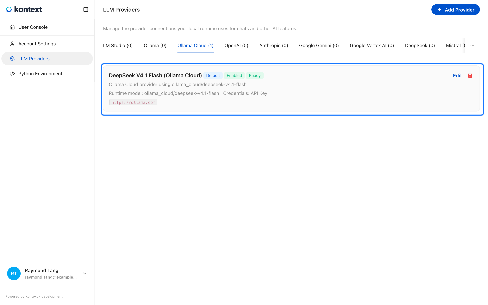
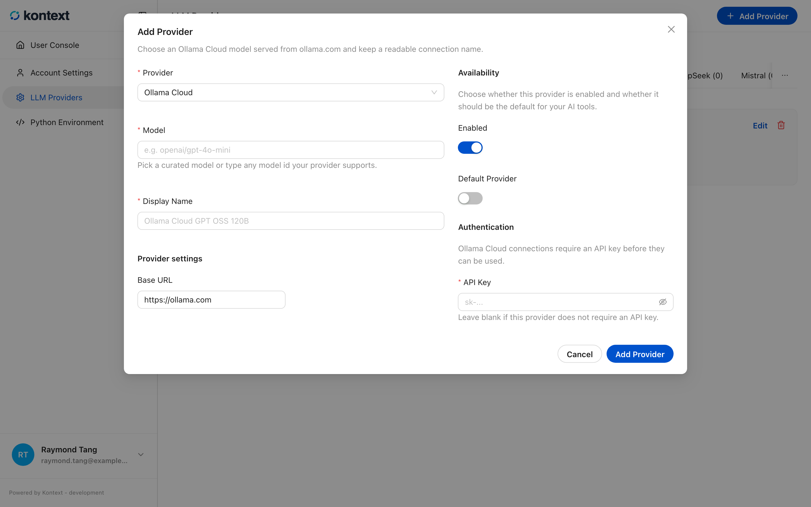
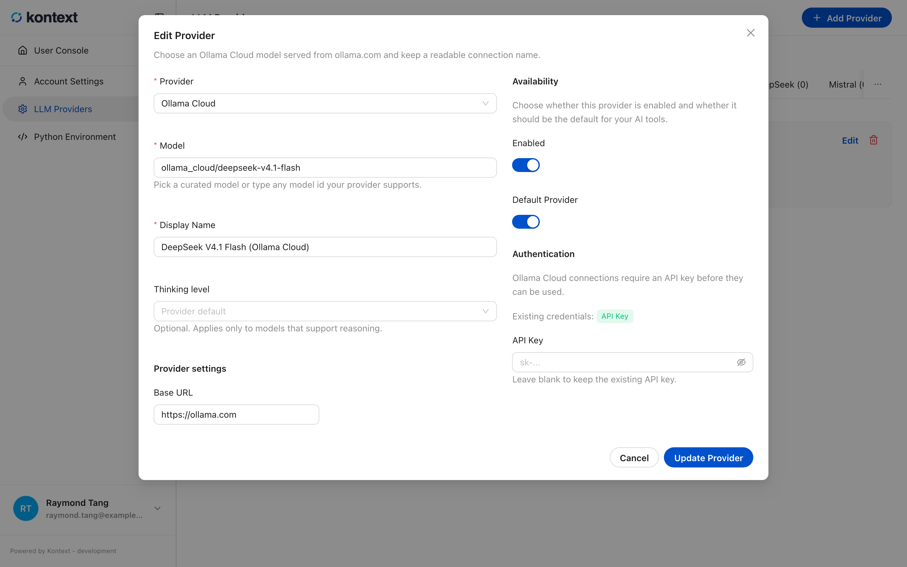
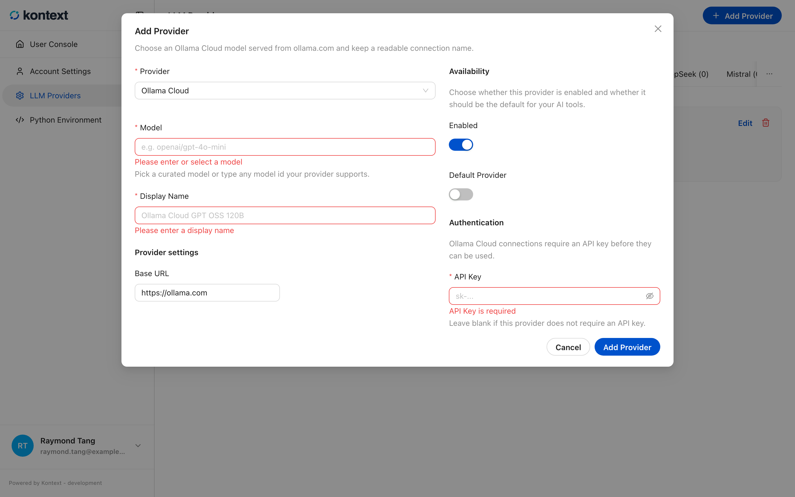

# Connect a model provider

Chats and agents need a language model. A **model provider** is one connection
to a provider: the model it should use, where the endpoint lives, and the
credentials that authorize it. A local runtime starts with the curated model
catalog but no connections, so the first chat asks you to add one.

Providers are user-level, not project-level. A connection you add is available to
every project you can open.

## Supported providers

| Provider | Connection type | Credentials | Notes |
| --- | --- | --- | --- |
| LM Studio | Local, OpenAI-compatible | Optional API key | Default endpoint `http://localhost:1234/v1` |
| Ollama | Local, OpenAI-compatible | Optional API key | Default endpoint `http://localhost:11434/v1` |
| Ollama Cloud | Cloud, native | API key | Default endpoint `https://ollama.com` |
| OpenAI | Cloud, native | API key | Endpoint can be overridden |
| Anthropic | Cloud, native | API key | Claude models |
| Google Gemini | Cloud, native | API key | Gemini models |
| Google Vertex AI | Cloud, native | Application Default Credentials or API key | Also needs a Google Cloud project and location |
| DeepSeek | Cloud, OpenAI-compatible | API key | Default endpoint `https://api.deepseek.com/v1` |
| Mistral | Cloud, OpenAI-compatible | API key | Default endpoint `https://api.mistral.ai/v1` |
| OpenRouter | Cloud, OpenAI-compatible | API key | Default endpoint `https://openrouter.ai/api/v1` |
| Azure OpenAI | Cloud, native | API key | Needs the resource endpoint and deployment name |
| AWS Bedrock | Cloud, native | AWS access key and secret | Needs a region; optional session token |
| OpenAI-compatible | Any endpoint | Optional API key | Use for a gateway or a provider without a dedicated type |

For each provider you choose a curated model from the catalog, or type any model
id the provider supports. The connection also gets a display name, so a project
can tell two connections to the same provider apart.

## Add or edit a provider

Open **LLM Providers** from **Home** and select **Add Provider**. Choose
the provider type, pick or type the model, give the connection a name, then fill
in the endpoint or credentials that provider requires. **Enabled** makes the
connection usable; **Default Provider** makes it the first choice for new chats.
**Add Provider** validates the connection before saving it. **Edit** reopens the
same form for a saved connection, and missing required fields are reported in
place instead of saving a partial connection.

<!-- docs:capture 10-connect-a-model-provider hash=f4237c4300ef -->
1. **LLM Providers** groups connections by provider type. Select a provider tab to see its connections; each card shows the model, whether it is the default, and which credentials are configured.
   
2. **Add Provider** chooses a provider type, a curated model, a display name, and the credentials or endpoint it needs. **Add Provider** in the dialog validates the connection before it becomes available.
   
3. **Edit** reopens a saved connection with its model, endpoint, and availability. Stored credentials are not shown; leave the field blank to keep them.
   
4. Saving without a model or display name reports the missing fields in place, so nothing is stored until the connection is valid.
   
<!-- /docs:capture -->

## Manage connections

Each provider tab groups its connections and shows how many exist. A card reports
the model, the provider type, the runtime model name, which credentials are
configured, and a readiness state:

- **Ready** means the last validation succeeded.
- **Needs attention** means validation failed; open **Edit** and check the
  credentials or endpoint.
- **Unknown** means the connection has not been validated yet.

**Edit** changes the model, name, endpoint, or credentials. Leaving a credential
field blank while editing keeps the stored value. **Delete** removes the
connection without deleting the model catalog.

Credentials are stored by the local server and are never returned to the browser;
the card only reports which fields are set.
