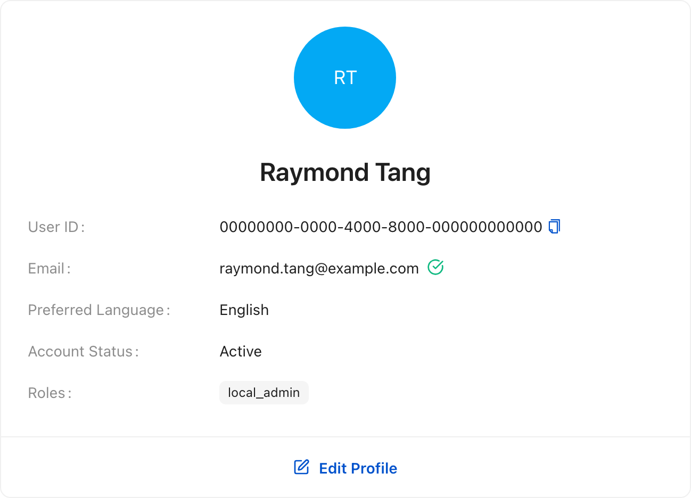
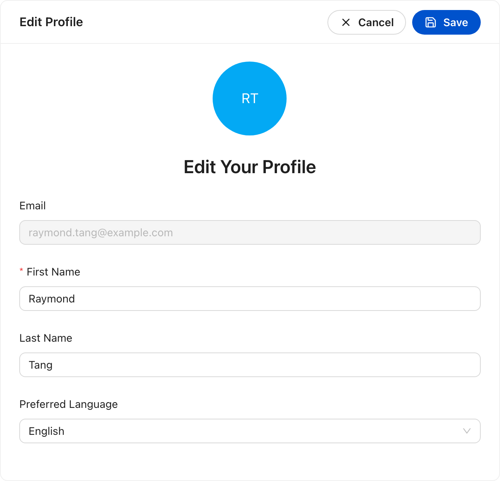

# Account

The account screen holds the settings that belong to you rather than to a project:
the local profile that owns this workspace.

## Your profile

**Account Settings** shows the local profile: name, email, preferred language,
account status, and roles. **Edit Profile** changes the first name, last name,
and preferred language; the email address is fixed. The user id is assigned when
the local workspace is created.

<!-- docs:capture 11-account hash=ca819014640f -->
1. **Account Settings** holds your profile: name, email, language, and the local account details. **Edit Profile** changes them in place.
   
2. Select **Edit Profile** to change the first name, last name, and preferred language. The email address is fixed; **Save** updates the local profile and **Cancel** discards the change.
   
<!-- /docs:capture -->
