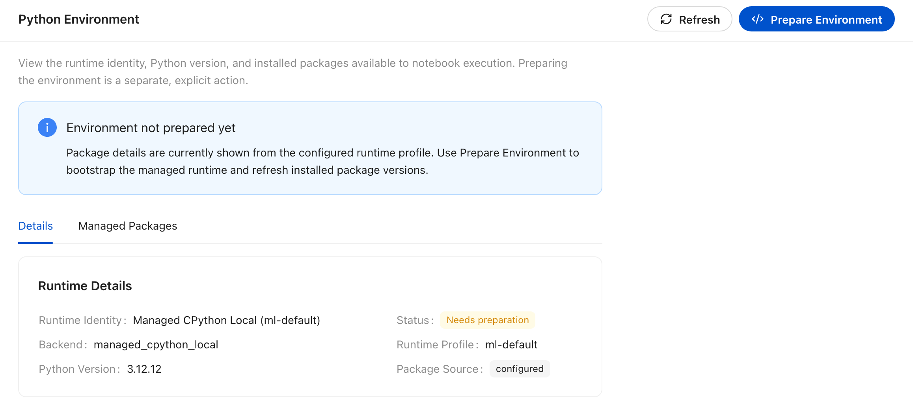
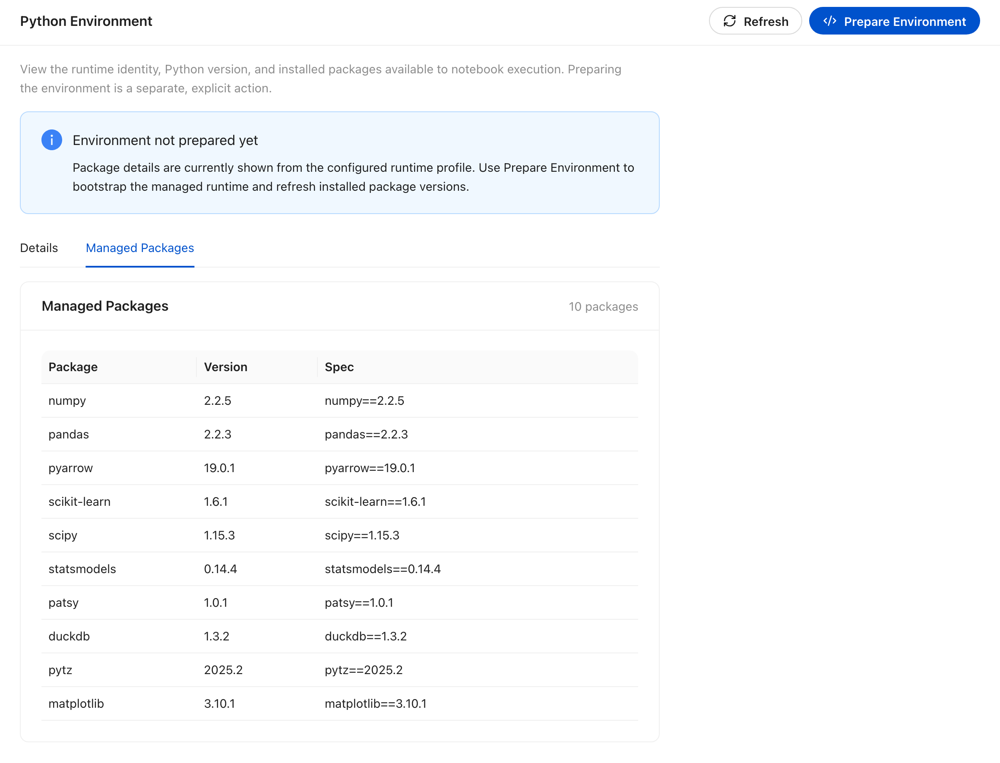

# Python environment

Notebook and chat Python blocks do not run in the server process. They run in a
managed runtime that Kontext inspects and can prepare for you.

## Runtime details

**Python Environment** describes the runtime that executes Python blocks. The
**Details** tab reports the runtime identity, backend, Python version, profile,
and whether the environment has been prepared. **Managed Packages** lists the
packages that come with the runtime profile.

The local runtime ships with a configured profile but is not prepared until you
ask: **Prepare Environment** bootstraps the managed runtime, and **Refresh**
re-reads its state. Prepare once after installation, and again after changing the
Python environment configuration.

<!-- docs:capture 12-python-environment hash=83d25c2667e4 -->
1. **Python Environment** reports the runtime identity, backend, Python version, profile, and preparation status, with actions to prepare or refresh the runtime.
   
2. **Managed Packages** lists the packages that come with the selected runtime profile and the version and spec Kontext resolved for each one.
   
<!-- /docs:capture -->
