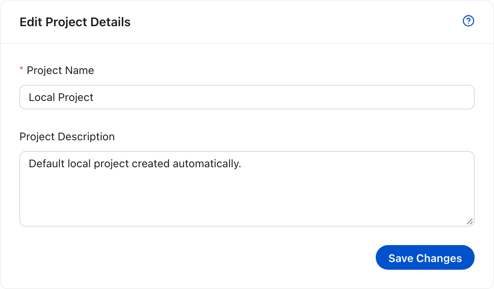

# Project settings

A project owns its data sources, files, chats, knowledge, and jobs. Creating and
opening projects is covered in [Open or create a project](02-create-a-project.md);
this page covers the settings that apply to the project you are already in.

## Edit project details

Open **Settings** in the project sidebar. The **General** tab edits the project
name and description. **Save Changes** updates the project wherever it appears.
In local mode, the local profile is the only member, so the change applies to
the whole workspace.

The project code is fixed when the project is created because it appears in every
project URL. In local mode there is no **Access & Permissions** tab: the local
profile owns every project, so there are no other members to invite.

<!-- docs:capture 13-project-settings hash=d179e858a5c8 -->
1. **Project Settings** edits the project name and description. In local mode the Access & Permissions tab is hidden because the local profile owns every project.
   
<!-- /docs:capture -->
