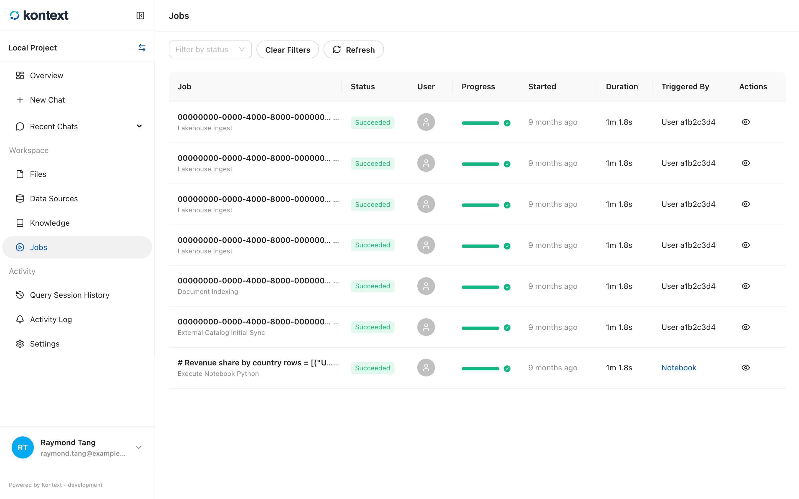
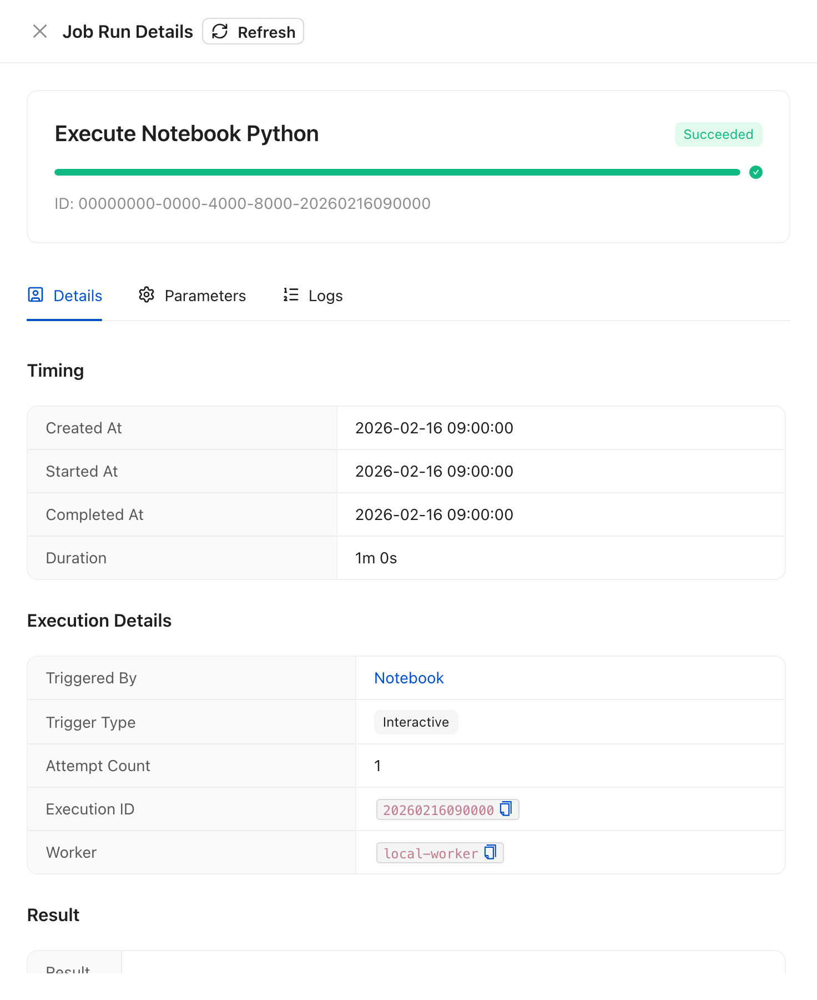
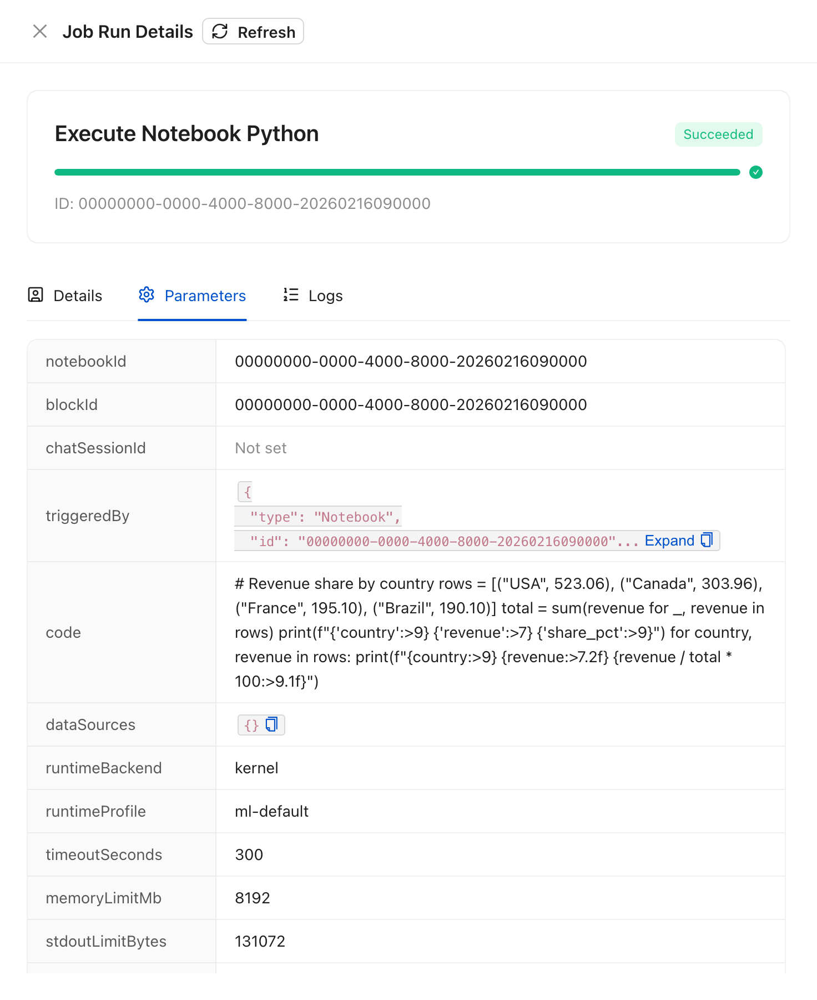
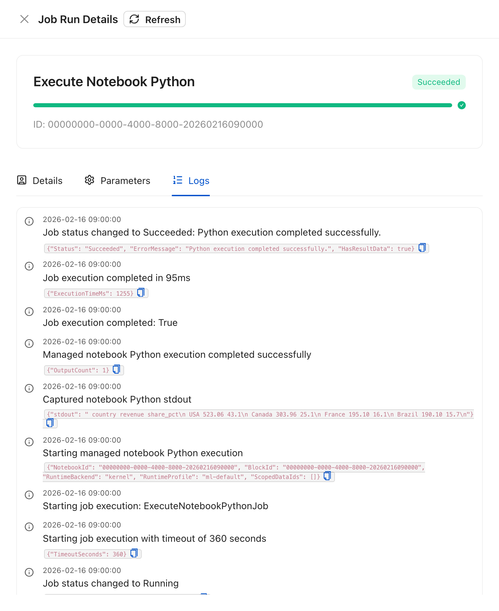

# Jobs and run details

Long-running work runs as a background job: syncing a data source, ingesting
uploaded files, indexing documents, or executing a managed notebook block. Jobs
run outside the request that started them, so the page is also the record of what
Kontext ran and when.

## The job list

Open **Jobs** in the project sidebar. Each row shows the job id, its name, status,
the user, progress, start time, duration, and trigger. **Filter by status** and
**Refresh** narrow the list; the actions on the right open the run, edit its
parameters, or cancel a queued run.

<!-- docs:capture 14-jobs hash=fa399625591d -->
1. **Jobs** lists background runs with their status, trigger, and timing. Filter by status or refresh the list.
   
<!-- /docs:capture -->

## Run details

Select the eye icon on a run to open **Job Run Details**. The drawer has three
tabs:

- **Details** shows the status, timing, trigger, attempt count, execution id, and
  worker.
- **Parameters** shows the payload the run was queued with.
- **Logs** shows the run log lines.

The same drawer opens from a SQL or Python block's **Run details** link, so you
can check what an execution actually did without leaving the notebook. Chart
blocks render their data in the browser and do not create a job run.

<!-- docs:capture 14-jobs#2 hash=d60890fd3c3e -->
1. Select the eye icon on a run to open **Job Run Details**. **Details** shows the status, timing, trigger, attempt count, execution id, and worker. The same drawer opens from a notebook block's **Run details** link.
   
2. **Parameters** shows the payload the run was queued with, so you can check what a run was asked to do.
   
3. **Logs** shows the run's log lines, including the captured output and timing for a Python execution.
   
<!-- /docs:capture -->
