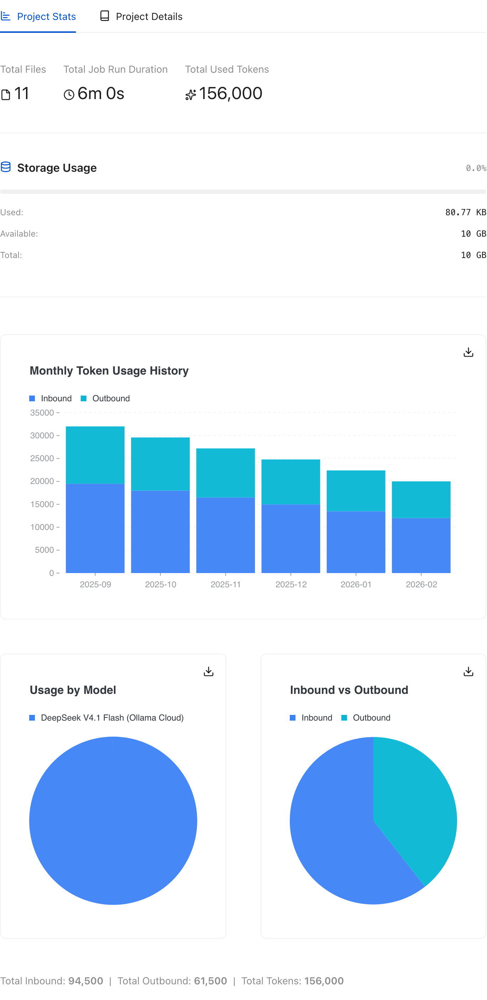
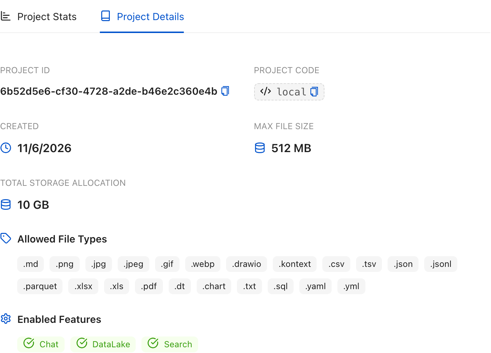

# Project overview and usage

Selecting a project opens its **Overview**, the project's home screen. It shows
the project's identity, usage, and shortcuts to the files, notebooks, and chats
that belong to it.

## Project stats

The **Project Stats** tab is open by default. It summarizes:

- **Total Files** and **Total Job Run Duration** for the project.
- **Total Used Tokens** across the project's chats.
- **Storage Usage**, with used, available, and total space. Kontext warns when
  usage passes 80% and marks it as almost full at 95%.
- **Monthly Token Usage History**, with inbound and outbound tokens stacked by
  month. Below it, the same tab breaks usage down by model and by inbound
  versus outbound direction; a daily view appears when daily data exists.

These totals are useful before importing a large data set or running an
expensive job, and when checking how much of a model budget a project used.

## Project details

The **Project Details** tab shows the project ID and code (both copyable), the
creation date, the project's maximum file size and total storage allocation, the
allowed file types, and the enabled features. The project code is fixed because
it appears in every project URL.

To edit the project name or description, or to review access settings, open
[Project settings](13-project-settings.md).

## Resources and help

The right column links to the project's **Files**, **Notebooks**, and the
getting-started guide. **Upload Files** requires contributor access; **New Chat**
is available to everyone with access to the project.

<!-- docs:capture 15-project-overview hash=f802364f0a89 -->
1. The **Project Stats** tab summarizes files, job duration, total tokens, storage usage, and monthly token history.
   
2. The **Project Details** tab shows the project ID, code, creation date, and file-size limit.
   
<!-- /docs:capture -->
