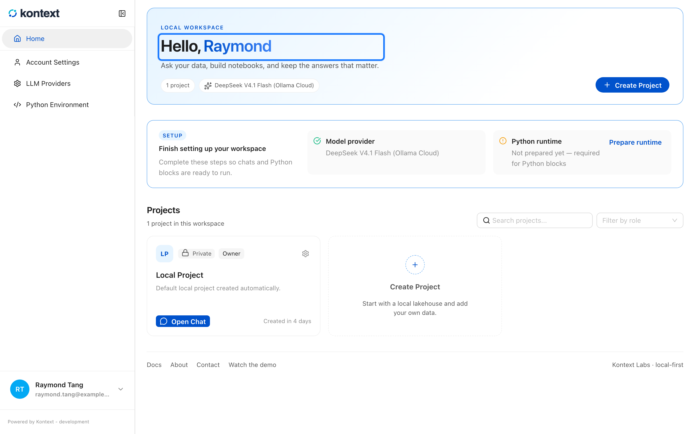

# Use the macOS desktop app

The macOS app includes Kontext Studio, its Python runtime, and the packages
notebooks need. There is no separate Python install and no terminal step. It
requires macOS 13 Ventura or later. The download is large — several hundred
megabytes — because the analysis runtime is bundled.

## Download

Open the [latest release](https://github.com/kontext-tech/kontext-studio/releases/latest)
and download the file for your Mac:

| Mac | File |
| --- | --- |
| Apple Silicon (M1 and later) | `Kontext-Studio-<version>-macOS-arm64.dmg` |

Only Apple Silicon Macs are supported in this beta. To check, choose  → About
This Mac; the Chip row should say Apple M…. Intel Macs can use the
[command-line install](https://docs.kontext.tech/user-guide/install-and-start/)
instead.

## Install

1. Open the downloaded DMG.
2. Drag **Kontext Studio** into **Applications**.
3. Open **Applications** and double-click **Kontext Studio**.

### First launch of the unsigned beta

The current beta is not yet notarized by Apple. On first launch macOS may say it
cannot verify the app. Do one of these:

- Open **System Settings → Privacy & Security**, scroll down, and click
  **Open Anyway** next to Kontext Studio. Try again within about an hour.
- Or run this in Terminal:

```bash
xattr -dr com.apple.quarantine "/Applications/Kontext Studio.app"
```

Only use these steps for an app downloaded from this repository's Releases
page.

## First run

The app starts its local server and opens the workspace. Create the local
profile, then create a project. The app works offline. Model providers and the
semantic search model may download data the first time you use them.

## Where your work lives

| What | Where |
| --- | --- |
| Projects, files, chats, settings | `~/.kontext` |
| Logs | `~/Library/Logs/Kontext Studio` |

The app and the command-line install share `~/.kontext`. Do not run both at the
same time against the same workspace.

## Update

Download the newer DMG from the latest release and replace the app in
Applications. Your workspace is not touched. Use **Help → Check for Updates**
to open the release page.

## Uninstall

Drag **Kontext Studio** from Applications to the Trash. To delete the workspace
as well, remove `~/.kontext`. That permanently deletes projects, files, chats,
and settings.

## Troubleshooting

- **The app does not start.** Open **Help → Open Logs** and check
  `desktop.log`. Include the last lines when reporting an issue.
- **A download did not appear.** The app asks where to save it. Check the
  folder you chose.
- **The window is blank after an update.** Quit and reopen the app. If it
  persists, open the logs and report the issue.
- **An external database is missing.** The first desktop release includes local
  files, DuckDB, notebooks, and agents. External warehouse connectors are not
  bundled yet.


